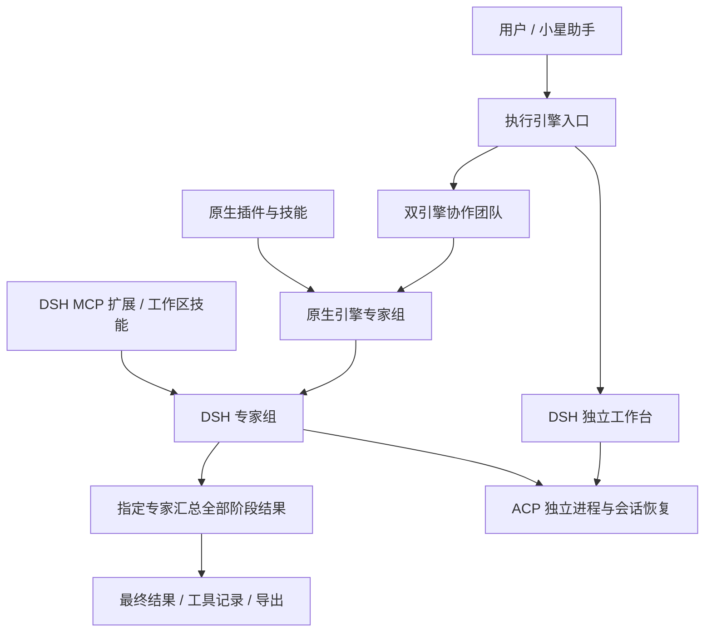
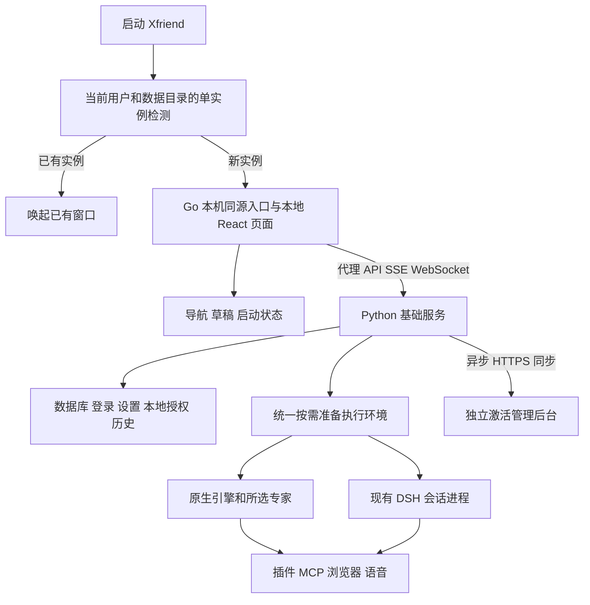
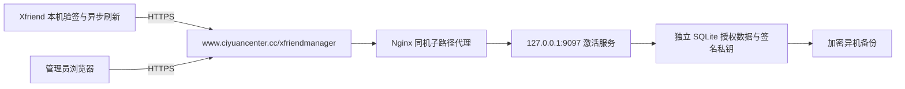

# Singu Xfriend 1.2 改造方案

> 本文保留历史设计与逐阶段实施记录，各节的完成状态以当时记录为准。当前 1.4.4 架构见 [项目设计说明](xfriend-project-design.md)，阶段演进见 [项目日志](development/xfriend-project-log.md)，版本变化见 [更新记录](../CHANGELOG.md)，最新性能见 [启动验收](development/xfriend-1.4.4-startup.md)。后续实现可能已经补齐早期章节的待办，不应只读取旧章节判断当前状态。

审阅日期：2026-10-11。状态：**第 1—19 节保留历次设计与实施记录，第 20 节记录 1.4.0 交付，第 21 节记录助手、引擎入口与授权改造，第 22 节为启动优化与激活后台部署方案；22.11 保留首批测量，第 23 节记录后续 1.4.1 本地五天试用客户端。规划指标不代表已达标，部署包不代表已上线。**

阅读入口：查看[最新启动与部署方案](#22-xfriend-启动优化与激活后台部署方案)、[实际完成范围](#17-2026-10-11-实施记录)与[前期后续改进方案](#18-后续改进方案与建议)。本文中的未来版本号、接口和目标均为建议，不代表已交付功能或确定发布日期。

本方案依据当前本地代码，包括已有桌面化、品牌修改和小星助手的改动。产品名称保持 **Singu Xfriend**，程序名保持 **Xfriend.exe**，运行数据目录保持 **.xfriend**。按照已确认的范围，内部 Python 依赖名称保留兼容。

## 1. 结论与版本范围

七项需求可以逐步接入。建议保留现有 **Go/Wails 桌面壳 + React 界面 + Python/FastAPI 服务**，在现有程序内增加小星设置、声音工作室、会话导出和平台协同。无需为了整合 PCMATE 或 DeepSeek Harness 再迁移为 Electron。

当前讨论的候选架构是**插件化能力体系**：保留“Xfriend 内置引擎”，将 DSH 作为另一执行引擎，通过插件注册。DSH 插件还可提供专家模板，使用户既能直接选择 DSH 执行，也能把 DSH 专家加入协作流程。插件、专家与引擎共享安装发现和配置入口，但运行职责保持明确；详细关系见第 16 节。以下双引擎和混合团队内容用于评估目标结构，不代表已确定全部在 1.2 一次实现。

PCMATE 当前建议**保留独立部署/发布能力，通过连接器插件接入 Xfriend**。共享的协同核心可被独立客户端或 Xfriend 管理：设备节点可以只部署协同服务，助手用户可在 Xfriend 的“平台协同”中操作。现有 PCMATE 暂不因架构讨论被删除或强制合并。最终产品是否同时保留两个完整桌面客户端，取决于独立设备接入的需求；这是待决策项。

目标版本统一为 **1.2.0**，产品界面可显示“1.2”。实施时同步桌面构建、Python 元数据、安装包和更新版本；保持现有安装身份、用户目录和迁移链稳定。不要仅修改安装包文件名。

需求范围（下列是设计目标，具体分期尚待收敛）：

1. 小星助手配置入口与现有悬浮窗接通。
2. 小米语音识别、合成、声音设计、声音克隆与声音库。
3. 专家、团队、智能体的分段会话导出。
4. 覆盖安装保留数据，并具备可验证的备份与恢复流程。
5. PCMATE 的平台登录、设备注册、服务连接和协同任务接入。
6. RDP、SSH 仅设计连接配置与接口，暂不实现。
7. DSH 引擎插件、专家入口及双引擎协作的候选设计，共用执行接口、历史与权限适配。

## 2. 代码基线与已有能力

当前主程序以本地工作区为准，不覆盖已有未提交改动。对照项目：

- `D:\XMATE\singu-x-mate\nuwa-electron-shell\crates\agent-electron-client`：本地 PCMATE 定制代码，审阅时该仓库 HEAD 为 `9fb6f4f`；同时存在本地改动，不能把功能状态完全等同于这个提交。
- `D:\deepseek-harness`：审阅 HEAD 为 `d743267388`，开发预览版本；Python SDK 源码版本为 `0.0.0.dev0`。集成时固定完整提交和构建产物校验值。

已有能力与需要补充的部分：

- 小星已有独立置顶窗口、文字输入、智能体选择、Windows 语音唤醒和录音识别入口。缺少统一设置入口及完整的语音输入输出配置体验。
- `infra/voice` 已有 MiMo ASR、基础 TTS；尚未完成声音设计、克隆和用户声音库。
- 会话已有兼容新旧历史格式的 JSON 导出接口。PDF、DOCX、HTML、图片需要在此基础上增加选择、规范化和渲染层。
- 桌面升级已有主 SQLite 数据库备份和运行时目录替换；尚不足以证明所有智能体工作区、历史检查点都能恢复。
- 已有 ACP runner 配置与权限请求处理。接入 DeepSeek 仍需适配进程生命周期、会话恢复、取消及结果归档。
- 当前远程桌面模块主要是主机屏幕采集与操作，不等同于连接其他电脑的 RDP 客户端。

## 3. 整体结构

```text
Wails 桌面壳
  ├─ 主窗口：小星设置 / 声音工作室 / 会话导出 / 平台协同
  ├─ 小星悬浮窗：唤醒 / 文字 / 语音 / 调用专家与团队
  └─ 原生能力：窗口 / 托盘 / 文件选择 / 运行时安装与升级
                 │
          React 通过 /api 调用
                 │
          FastAPI HTTP 适配层
                 │
  ├─ 语音领域服务 → MiMo API
  ├─ 统一消息归档 → 历史展示 / PDF / HTML / DOCX / 图片
  ├─ 平台协同控制层 → 独立 PCMATE 服务 → 平台 / 隧道
  │
  └─ 会话与团队调度 → 统一 EngineRouter
                         ├─ NativeEngineAdapter → Xfriend 内置引擎
                         └─ DeepSeekEngineAdapter → ACP → DSH 独立进程
```

领域逻辑放在 `infra/`；API 层负责身份校验、参数和响应；React 通过 `dashboard/src/api/` 调用；原生窗口逻辑留在桌面壳。新运行时不直接读写主程序数据库，不绕过现有用户和工作区权限。

## 4. 小星助手配置入口

### 用户操作

在主界面增加“设置 → 小星助手”。悬浮窗齿轮和托盘菜单打开同一个页面，避免多套设置。

页面包含：

- **常规**：显示或隐藏悬浮窗、默认调用的智能体或团队。
- **唤醒与输入**：启用语音唤醒、可修改的唤醒词（默认“小星”）、麦克风选择、输入音量和识别测试。
- **语音回复**：启用自动朗读、选择声音、试听、停止播放；手动停止和新的输入能够中断上一段朗读。
- **语音服务**：显示当前 ASR/TTS 服务状态，提供跳转配置或管理员配置入口；普通用户不接触服务密钥。
- **声音工作室**：进入声音设计、克隆与我的声音库。

语音唤醒默认关闭，沿用用户已接受的手动开启方式。唤醒检测与唤醒后的语音识别分开：继续复用现有 Windows 唤醒能力，识别任务可以使用已配置的云端服务。此设计不承诺额外提供离线 MiMo ASR。

状态流为“待机 → 唤醒/手动录音 → 识别 → 智能体处理 → 朗读 → 待机”。界面明确显示当前状态；朗读时避免扬声器内容再次触发唤醒。关闭语音功能应释放录音设备。

### 代码改造点

- `desktop/src/assistant.go`、`desktop/src/assets/assistant.html`：统一打开设置页面，设置变化同步到悬浮窗和唤醒组件。
- `dashboard/src/pages/DesktopAssistant/`：连接语音输入、输出与设置状态。
- `dashboard/src/hooks/useVoiceInput.ts`：已有 `recordedBlobToWav`；提取为共享音频工具供小星复用。
- `dashboard/src/pages/DesktopAssistant/useAssistantVoice.ts`：当前直接使用 MediaRecorder，可能产生 WebM；不能继续直接交给只接受 WAV/MP3 的 MiMo 适配器。转换失败时给出明确提示，不把不支持的格式继续提交。
- 服务端可用性判定不能只做 `Boolean(active.stt)`，需要区分浏览器识别与已配置的云端识别。
- 设备 ID、窗口位置等按本机保存；默认智能体、声音选择等按用户保存；服务密钥继续由后端管理。

验收：从三个入口进入同一设置页；重启设置保持；唤醒词修改生效；麦克风拒绝授权、服务未配置、识别失败均可恢复；文字输入独立可用；播报不造成自我唤醒循环。

## 5. 小米语音与声音工作室

### 复用基础语音服务

`src/octop/infra/voice/adapters.py` 已有 `transcribe_mimo` 和 `synthesize_mimo`，分别使用 `mimo-v2.5-asr`、`mimo-v2.5-tts`。`VoiceManager` 和现有语音配置页面应扩展，而非另建一套密钥和服务选择机制。

ASR 流程：麦克风录音 → 16 kHz 单声道 PCM16 WAV → 现有语音服务 → 可查看的识别文字 → 提交给所选助手。采样转换复用现有前端逻辑，无需仅为这个问题额外捆绑 FFmpeg。

基础 TTS 流程：助手回复 → 当前声音配置 → 合成 → 播放。长回复分段、停止后丢弃过期音频，避免多个回复同时朗读。音频输出设备选择以桌面 WebView 的实际能力为准，不支持时明确使用系统默认设备。

### 声音设计与克隆

官方示例确认两者是不同模型与请求结构：

- **声音设计**：`mimo-v2.5-tts-voicedesign`，输入声音描述与试听文字，返回音频。不能把它当作基础 TTS 的一个 `voice` 预设。[官方 VoiceDesign 示例](https://github.com/XiaomiMiMo/MiMo-Skills/blob/main/skills/mimo-v2-5-tts/scripts/mimo_tts_voicedesign.py)
- **声音克隆**：`mimo-v2.5-tts-voiceclone`，在 `audio.voice` 中提交参考音频 Data URL，并提供要朗读的文字；参考示例支持 WAV/MP3。[官方 VoiceClone 示例](https://github.com/XiaomiMiMo/MiMo-Skills/blob/main/skills/mimo-v2-5-tts/scripts/mimo_tts_voiceclone.py)

建议提供三个页面标签：

1. **设计声音**：填写声音描述、试听文本 → 生成 → 试听 → 命名保存。
2. **克隆声音**：上传或录制参考音频 → 校验格式与服务限制 → 输入试听文本 → 试听 → 命名保存。
3. **我的声音**：试听、重命名、删除、设为小星默认声音。

声音设计的音频可保存为参考样本，后续通过克隆模式保持相近音色。官方工作流也采用“设计音频 → 克隆参考”的方式；当前审阅的示例未提供永久 `voice_id`，因此由本程序管理声音记录与样本。[官方语音工作流](https://github.com/XiaomiMiMo/MiMo-Skills/blob/main/skills/mimo-v2-5-tts/SKILL.md)

### 数据与接口

扩展现有语音领域模块和 `api/routers/voice.py`：

- 保留 `/api/voice/stt`、`/api/voice/tts` 的已有调用方式；新增模式和声音选择参数时保证旧配置可读。
- 增加声音设计、克隆试听、声音库 CRUD 和试听音频下载接口，路由声明类型化请求/响应及 OpenAPI 描述。
- 新增按用户归属的 `voice_profiles` 资源记录：公共 ID、名称、模式、提供商引用、模型、描述、参考样本 ID、时间。API key 不复制到声音记录。
- 样本与生成音频放在 `.xfriend` 下的应用媒体存储，记录归属和保留策略；不能写进安装目录。
- 新表按仓库规范提供 SQLite/PostgreSQL 成对迁移，编号依据实际已发布版本选择。
- 不把某个模型的参数直接套给其他模型；默认请求地址使用已核对的 MiMo 官方地址，其他套餐地址先通过能力测试再启用对应功能。

验收：四项能力分别通过真实服务测试；参考音频及声音库重启可用；不同用户互不可见；密钥不返回前端；错误模型、无额度、超时、非法音频可明确提示并重试。真实音色和账号权限必须通过实际 MiMo 账号验证，静态审阅不能替代此验收。

## 6. 对话分段导出

### 已确认的选择范围

用户已确认支持：**单轮问答、勾选多条消息、选择起止范围、整个会话**。这里按消息/问答轮次选择，不要求模型自动猜测文章章节。

在专家、团队、智能体会话中共用“导出”入口；消息菜单提供“导出这一轮”。先选范围，再选择 PDF、HTML、DOCX、PNG。预览显示范围、消息数和角色；默认导出用户可见正文，工具执行详情可选。

单轮应包括该次用户输入和对应的助手输出，包含期间可见的多段回复；未完成轮次标注状态。多选按原会话顺序输出。起止范围在 UI 上包含两端，后端统一处理边界，不能直接误用数据库半开区间。

团队默认导出主会话，保留发言者标签；成员子会话通过明确选择单独导出或附录呈现，不把不同成员消息按时间盲目拼接。服务器必须逐一检查所选线程的访问权限。

### 读取与渲染

已有入口 `GET /api/agents/{agent_id}/threads/{thread_id}/history/export` 返回未渲染 JSON；`infra/history/reader.py::export_messages` 能分页读取新归档和旧投影/检查点。新增文档导出应复用此能力，不能只读某张新表，否则旧会话可能缺失。

领域层形成统一的 `ConversationDocument`：会话信息、服务器时区、稳定消息 ID、轮次 ID、角色、正文块、附件引用、导出边界和快照版本。导出过程中继续收到的新消息不应改变已经选定的范围。没有稳定旧消息 ID 时，使用固定历史快照内的可复现标识，不用当前屏幕列表下标充当永久 ID。

四种格式从同一份文档数据生成：

- **HTML**：可离线打开的单文件，内嵌样式及允许导出的图片；不运行会话中的脚本。
- **PDF**：隔离的完整导出页面，通过 Chromium/Playwright 打印，控制分页、页眉页脚和中文字体。
- **PNG**：使用同一完整导出页面生成；内容较长时分张图片并打包 ZIP，避免单图尺寸和内存限制。
- **DOCX**：使用已有 `python-docx` 依赖生成可编辑段落、标题、列表、表格、代码块和图片；不采用整页截图伪装成可编辑文档。

已有 Playwright、Pillow、python-docx 等依赖可复用，但 Python 依赖存在不代表安装包已带齐 Chromium 与字体。实施时检查便携运行时的浏览器资产，确保没有开发环境的电脑也能导出。PDF/图片不依赖聊天页面的虚拟滚动 DOM，避免只导出屏幕上看得见的消息。

建议新增 `infra/conversation_exports/`，API 层只校验权限和分发任务；前端新增共用范围选择与预览组件。较长导出用后台任务，支持进度、取消和下载过期清理；渲染和文件 I/O 不阻塞主事件循环。附件通过现有工作区访问接口读取，禁止拼接路径越过用户工作区，也不自动请求正文中的任意远程资源。

验收：旧会话与新会话各覆盖四种范围、四种格式；中文、代码、宽表格、图片、公式、长内容都做实际打开和视觉检查；导出时持续收消息仍保持快照一致；跨用户访问失败；服务器时区显示一致；团队角色和子会话范围正确。

## 7. 安装升级与数据保留

### 当前基础与缺口

运行数据已放在 `.xfriend`，与程序安装目录分离；已有品牌目录迁移逻辑。`desktop/src/portable_upgrade.go` 会备份主 SQLite 数据库，`download.go` 使用暂存目录替换运行时。

需要特别处理两点：

1. 主数据库之外还有智能体会话检查点、记忆、工作区内容和附件。只保存主数据库不能证明完整对话可恢复。
2. `infra/backup/chats.py` 中普通备份策略默认可排除聊天。升级备份必须显式包含聊天及对应工作区，不能直接沿用默认排除策略。

运行时替换后也不应立即删除旧运行时，应等服务启动、迁移和健康检查成功后再进入旧版本清理阶段。

### 目标流程

```text
校验安装包 / 新运行时
  → 请求旧应用退出并停止其拥有的子进程
  → 确认没有活跃写入
  → 备份数据库、会话检查点、配置及用户文件，写入备份清单
  → 暂存并切换新运行时
  → 执行幂等迁移
  → 启动服务并检查就绪状态、数据库与历史读取
  → 标记升级成功，按保留策略清理旧运行时
```

备份范围包括用户、聊天历史、智能体配置、工作区、附件、记忆、语音配置与声音样本、平台绑定配置、DeepSeek 会话映射及其持久化目录。外置工作区和自定义 SQLite 路径同样进入备份清单；远程工作区按后端能力处理，不能只复制默认目录。SQLite 使用一致性备份 API，不能在写入中只复制 `.db` 而漏掉 WAL。

PostgreSQL 不适用本地 SQLite 备份，需要独立的数据库备份/恢复流程；桌面首次验收以默认本地 SQLite 为主，不宣称此路径已经覆盖 PostgreSQL。

出现迁移或启动失败时保留日志和可恢复快照。回退必须保证运行时与数据版本配对；不能让旧二进制直接打开已升级且不兼容的数据库。恢复前保留失败现场，避免覆盖用户可能新增的内容。

安装器保持相同应用身份和安装记录，普通升级不删除 `.xfriend`。品牌迁移保持幂等，不在已有新目录时重复搬迁覆盖。程序更新与用户主动清空数据分离。遇到旧程序占用文件时提示并关闭本应用进程，不能按端口随意结束其他程序。

验收：干净安装、当前旧版本覆盖升级、带自定义路径升级、运行中升级、失败恢复各执行一次；核对用户数量、会话/消息、附件、工作区和设置；重启后无需重新初始化账号；原有对话能继续，而不仅是列表名称仍存在。

## 8. PCMATE 平台协同

### 产品形态：共享协同核心，支持独立与内嵌两种宿主

三个选择的取舍：

- **完全分成两个软件**：适合两个产品服务不同用户、需要分别发布销售的情况。优点是可独立部署；代价是用户切换入口、重复设置工作区、分别查看连接状态，还需要处理两个程序的进程和端口冲突。
- **所有代码和生命周期合在一起**：界面统一，但平台登录、隧道、文件服务故障更容易影响本地助手；启动与升级也更耦合，不利于本次启动提速目标。
- **推荐：协同核心独立，Xfriend 插件接入**：共同的服务协议供独立 PCMATE 和 Xfriend 使用，助手用户可以在 Xfriend 中操作，设备节点可以独立部署。需要维护共享服务的协议和兼容性，但无需复制两套注册、文件服务和隧道实现。

实施初期保留现有 PCMATE 的独立交付，先抽离/确认可复用的协同核心，Xfriend 通过可选连接器提供设置、状态和操作。核心稳定后，可以在 Xfriend 安装包中按需包含协同组件，不要求用户另外启动 PCMATE 的完整 UI。平台账号仍按平台要求单独登录或绑定，不假设本地账号就是平台账号。

判断独立产品是否值得继续维护的条件：是否存在只需要平台接入、无需本地助手的电脑；是否要求关闭 Xfriend 后仍执行平台任务；是否需要独立发布和维护周期。若这些需求都不存在，最终只保留 Xfriend UI 可以降低界面维护量；共享服务边界仍有价值。目前不把其中一种用户需求当作已确认事实。

同一设备、平台与账号范围内只能有一个协同服务所有者，两个 UI 复用经过身份确认的服务，不能各启动一条相同设备隧道。需要明确控制权、端口、设备 ID 和凭据归属；关闭一个 UI 是否停止服务，由“宿主托管”或“独立常驻”模式决定。独立常驻不是默认悄悄开启的行为。

现有 PCMATE 服务管理有 Electron IPC 和 session 依赖，需要先抽离这些宿主调用，才能形成真正可独立运行的组件。不能直接把 Electron 主进程文件当作无界面服务执行。平台断线、服务启动失败或组件未安装，只影响“平台协同”，不得阻塞本地助手和另一执行引擎。

### 审阅结果

本地 PCMATE 已有平台地址配置、账号登录、租户选择、设备注册、工作目录、本地服务管理、隧道状态和平台链接。核心注册协议集中在 `webSessionRegistration.ts`，UI 在 `PCMateHome.tsx`，Electron 适配分散在 `pcmateAuth.ts`、`webSessionHandlers.ts`、`processHandlers.ts`。

本地构建报告记录过“登录和设备注册通过，但隧道配置或服务启动失败”的情况。因此平台协同不能仅把页面和接口搬过来就标记为可用；必须与实际平台端进行端到端联调。

### 接入方式

增加侧栏“平台协同”，显示平台地址、账号、租户、设备名称、协同工作目录、服务状态和最近错误。操作包括登录、连接、重连、断开、打开平台。

宿主使用 Python 领域服务 `infra/platform_collaboration/` 管理平台协议适配、用户授权和连接状态，UI 通过类型化 API 调用。Wails 只负责目录选择、外部浏览器等本机能力。PCMATE 的隧道、文件和执行辅助服务保持独立进程，替换 Electron IPC、session、tray 等宿主调用，不在主程序内再启动完整 PCMATE Electron 界面。已可独立运行的组件尽量复用；需要改写的协议逻辑保留协议测试，避免形成两套并行且互相矛盾的设备注册状态。

按现有协议实现：

1. 登录 `/api/session/login`，必要时 `/api/session/tenant/select`。
2. 查询 `/api/user/getLoginInfo` 并确认当前登录主体。
3. 执行 `/api/sandbox/config/list`、必要时创建配置、再注册 `/api/sandbox/config/reg` 的流程。
4. 校验设备归属与隧道配置，启动对应本地服务，验证健康状态后才显示“在线”。

连接状态至少区分：**账号已登录、设备已注册、本地服务就绪、隧道已连通**。切换账号、租户或平台地址时停止旧连接，丢弃旧请求的迟到响应，防止新账号继续使用旧租户服务。

辅助服务按实际协同协议选择文件服务、代理隧道、agent runner 等；需要 Node 的组件再随运行时打包对应版本，不默认照搬全部 PCMATE 进程。进程由明确的所有者 PID/句柄管理；现有按监听端口杀进程的方式不直接移植。

设置与日志放在 `.xfriend/platform/`；平台认证状态由服务端管理。旧 PCMATE 配置可作为可选导入源，但账号、租户和设备归属重新核验，不直接合并旧数据库或移动原工作区文件。现有协议字段可保留内部兼容名，用户界面统一 Singu Xfriend 品牌，并保留被复用组件所需的第三方许可说明。

PCMATE 负责平台连接与设备协同，不作为第三套聊天引擎。需要本机智能体处理的平台任务，经租户/用户/工作区授权后交给统一 EngineRouter，使用任务指定且允许的引擎，或明确的默认引擎；旧平台请求未包含引擎字段时保持兼容默认行为。平台重发任务使用稳定任务 ID 防止重复执行。已有平台专用协议能力仍由协同组件负责，不能未经适配就全部改成聊天消息。

验收：真实平台登录与租户切换、设备注册、断线恢复、退出清理、重启恢复，以及平台下发一次真实文件/协同任务并收到结果。仅打开平台网页不算协同接入完成。

## 9. RDP 与 SSH：预留设计

1.2 不实施此功能。未来新增“远程连接”页面，共用连接档案：协议、名称、主机、端口、用户名、凭据引用、工作目录及显示选项。凭据和主机密钥信任信息独立管理，不把密码放进可读连接列表。

RDP 第一阶段调用 Windows `mstsc` 打开远程连接，成本较低；如果后续明确要求软件内嵌远程画面，再评估 FreeRDP/网关方案。SSH 使用受控 SSH 会话与终端组件，支持私钥引用、主机密钥校验、断开和重连。现有本机屏幕控制继续作为单独能力。

连接配置、状态、凭据接口与平台协同可以共用基础设置模式，但不能把“平台在线”当作已经授权远程控制其他电脑。

## 10. 候选架构：双引擎、专家入口与协作

此节保留目标架构的技术细节，用于评估改动范围。用户正在讨论这些关系，并未批准一次性重构全部历史、团队和插件系统。最小可验证切入点与统一抽象见第 16 节。

### 用户体验与选择规则

执行引擎决定任务循环、工具调用和运行状态；模型决定实际使用的模型服务。二者在界面上分别配置，不能把“DeepSeek 模型”选项当作“DeepSeek Harness 引擎”已经接入。

提供两个入口名称：

- **Xfriend 内置引擎**：保留当前运行时，旧智能体、旧会话默认继续使用它。
- **DeepSeek Harness**：经适配后直接运行新会话，可独立使用，也可由团队调度。

在“设置 → 执行引擎”管理运行时和默认选择；专家/智能体可设置自己的默认引擎；新建会话时允许选择或覆盖，创建后保存实际选项。小星跟随所选专家或智能体的会话引擎，也可新建使用另一引擎的会话。

已有会话中的每个实际执行会话固定所属引擎。修改默认引擎只影响新会话；跨引擎继续工作通过新建执行会话、携带选定的可见上下文和附件引用，并保留来源链接。内部检查点、隐藏状态和工具执行中间态不假定可以互转，也不把这项操作标记为原生会话恢复。宿主可以把父任务和不同引擎的子任务展示在同一个团队/任务页面，但每个子执行会话有独立身份。双引擎协作由明确工作流启用，默认不自动双跑或失败后换引擎重试。

验收上必须证明：选择 DeepSeek 的直接会话，即使内置引擎没有可用模型也能完成任务；请求不经过一次额外的内置引擎 LLM 路由。这是双引擎与原“委派工具”方案的实质区别。

### 统一接口与状态归属

建议在 `infra/engines/` 新增最小公共契约、路由器和两个适配器，保留现有代码作为 NativeEngineAdapter 的实现，不把现有运行时整体重写：

- `capabilities`：输入类型、工具审批、模型配置、恢复、分支、工作区类型等能力。
- `ensure_started`、`create_session`、`resume_session`：明确用户、智能体、线程及工作区范围。
- `stream_turn`：标准化文本、附件、工具进度、权限请求、用量、完成、错误等事件。
- `cancel_turn`、`respond_permission`、`close_session`、`shutdown`：关联到具体任务，不误停同一进程内其他会话。

`EngineRouter` 依据持久化会话绑定选择适配器，不通过一次模型调用判断路由。拟在智能体配置中增加默认引擎，在线程或独立 `thread_engine_bindings` 记录中保存实际 `engine_id`、运行时版本、上游 session ID、配置/能力快照版本；默认值对旧数据回填为内置引擎。若支持同一宿主线程重建上游会话，保留映射代次以识别迟到事件。

宿主管理可见消息、授权、来源、导出、语音和应用账号；每个引擎管理自己的执行检查点和运行状态。统一归档保存用户输入与规范化结果，包括结束状态、附件、权限及可获得的用量；缺少用量时标注未知，不能填成零。事件使用宿主有序编号和映射代次处理重复与迟到更新，不能假定所有 ACP 事件都有可重放的唯一编号。

目前以下路径耦合原引擎，必须纳入改造：

- `infra/gateway/process/processor.py` 与 `infra/history/legacy.py` 直接读取 `harness.graph.aget_state`。旧历史读取留在内置适配边界，DeepSeek 会话读取统一归档。
- `infra/gateway/process/agent_resolve.py` 从现有 HarnessAgent 取得 workspace。上传、附件、文件浏览要通过统一工作区访问边界，不能为了 DSH 临时绕过权限直接拼接本机路径。
- `infra/agents/teams/team_manager.py` 通过现有 manager 运行成员，并依赖原有团队状态。需要将成员执行入口接入统一适配器，同时保留团队编排语义。

专家人设、提示词和技能通过各引擎支持的配置方式注入；宿主工具可在明确授权范围内通过 MCP/适配服务暴露。并不意味着原引擎的所有 Python 工具、插件、记忆机制自动兼容 DSH。提供能力说明：无法支持的技能、远程工作区或会话操作在选择时提示，不能显示可用后静默忽略。

当前 DSH ACP 要求合法的本机绝对工作区。S3 等远程后端不能直接把 URI 作为 cwd；第一版只对经验证的工作区组合开放 DeepSeek 引擎。远程工作区若需本地同步，还要另行设计冲突、回传和权限，不隐式转换。

### 为什么选 ACP

DeepSeek Harness 是 TypeScript/Node 插件运行时。其 Python SDK 启动底层进程，并不意味着它是可直接替换现有 Python HarnessAgent 的同构库。

审阅的 SDK 公共协议提供 initialize、prompt、wait 等，但没有逐会话 cancel 方法；ACP profile 提供 prompt、cancel、resume、close 和权限请求。因此 **DeepSeekEngineAdapter 首选 `dsh --profile acp`**。ACP 是引擎与宿主之间的传输方式，不限制它只能被原引擎当作工具使用。

不能只填写一条 runner 命令就宣称完成：当前主程序的 ACP 调用路径主要创建新会话，而 DeepSeek 的恢复使用 `session/resume`，不支持以 `session/load` 替代。恢复后也不会重放完整旧 UI 消息，因此主程序需要持久化已展示的历史和远端会话映射。

### 团队与跨引擎协作

团队主会话、成员身份、任务关联和结果展示由宿主统一管理，成员执行进入 EngineRouter。团队设置可以指定默认引擎，成员可以明确覆盖；逐步达到同一团队中两种引擎协作的目标。它是额外的宿主编排工作，不能只依靠 DSH 自己的子智能体能力冒充现有团队兼容。

按“内置团队无回归 → DSH 单成员执行 → 同引擎多成员团队 → 混合引擎团队”顺序验证；各组合通过测试后才开放。验证包括任务分派、成员消息顺序、审批、整组取消、成员异常、恢复和导出。混合团队在未验收阶段明确不可选，不宣称已支持全部团队功能。各阶段进入 1.2 还是后续版本仍属范围决策，不能用设计文档代替实施完成。

### 运行时与兼容边界

需要实现：

- 固定版本的 Windows x64 ACP 运行时，包含自身 Node 与必要二进制；源项目已有 `deepseek-harness-runtime-bin` 的打包设计，但本地可分发构建是否成功仍需实际构建验证。
- 将 `DSH_HOME` 设置为 `.xfriend/engine-data/deepseek-harness/` 下按用户/智能体隔离的目录，引擎二进制另放版本化的 `runtimes` 目录，避免程序更新清理用户会话。`DSH_RESOURCE_CACHE` 也明确设置在应用管理范围。
- 启动/停止、超时和异常退出处理，以及 stdio 消息适配；阻塞进程操作不占用 Python 主事件循环。
- 主线程 ID 与 DSH session ID 的持久化映射；取消实际传递到 ACP；重连和重复事件不重复写入用户历史。
- 权限请求映射到现有审批界面，不默认将所有新 runner 配成完全可信。平台租户、应用用户与智能体工作区边界继续生效。
- 统一设置宿主产品身份为 Singu Xfriend；技术说明可以如实指出使用了 DeepSeek Harness，不能再次把依赖名称误当成产品身份。
- 更新、备份和卸载规则覆盖 DSH 持久化状态；更换模型或密钥不篡改既有会话的引擎归属。

共用的界面功能不等于引擎内部状态共用。每套引擎独立启动、停止和报错；未使用的 DSH 不阻塞应用启动。选择 DeepSeek 的会话只等待该引擎以及必要宿主服务就绪，不能为了展示主页而提前启动全部两套引擎和所有专家。

### 值得结合的设计

- **重复工具调用提醒**：参考 `packages/guard/repeat-tool-reminder/`。相同工具与规范化参数连续重复时提醒模型调整策略；设置白名单，不能把合理轮询误判为死循环。
- **工具结果裁剪**：参考 `packages/compaction/compaction-tool-result-pruner/`。上下文内保留摘要或首尾片段，原始结果仍可追溯，不能破坏用户历史与导出。
- **协作式取消和超时**：参考 `packages/guard/timeout-policy/`。给支持取消的工具传递信号，对本程序拥有的子进程进行明确清理；不能把协作式超时宣传为任何外部进程都能强制终止。
- **事件归档和会话状态**：参考 core/session 与会话查询模块，结合现有历史归档，补充流断开、恢复和重复事件的测试。

DeepSeek 一侧优先直接使用其运行时机制，减少复制上游代码。内置引擎确有需要时再适配相应 Python/LangGraph 扩展点，并独立维护来源和测试。优先完成两套引擎的共同契约与取消映射；裁剪机制只有在历史和回放兼容性验证通过后启用。DSH 的完整 Web/Electron UI、独立账号存储和 Office 大型运行时不列入首版合并。

验收：两套引擎各自独立完成直接会话、权限同意/拒绝、取消、应用重启后恢复、异常退出处理、多用户隔离、中文品牌身份、统一历史与导出；旧会话没有被自动换引擎，另一引擎不可用不导致全局失败。团队按上述组合逐项记录支持状态。保留上游 MIT 许可及构建来源记录。

## 11. 实施顺序与难度

以下是候选的完整实施顺序。第 16 节提出先验证最小插件与 DSH 专家闭环，再决定全面双引擎改造范围；此清单不是已经批准的一次性交付承诺。每阶段都应形成可验证结果：

1. **数据、版本与启动基础，中高难度**：升级快照、恢复流程、版本统一、安装身份稳定，并建立分阶段启动耗时基线。同期明确最小引擎契约与消息归档格式，后续语音和导出依赖此边界。验证旧安装覆盖升级后用户与完整对话可继续。
2. **双引擎直接会话，高难度**：抽取执行契约并保证内置引擎无回归，再增加 DeepSeek 直接会话、配置选择、持久化、工作区适配。它比仅增加委派工具的改动更大，新增迁移和回归范围应计入 1.2 排期；执行引擎按需启动，不拖住基础界面。
3. **小星入口与语音，中等难度；声音工作室中高难度**：先统一设置和录音格式，再接四类 MiMo 能力；小星通过统一接口选择引擎。验证真实录音识别、回复播报、声音设计与克隆保存。
4. **分段导出与团队适配，高难度**：共享文档模型、范围选择、四格式渲染；覆盖两套引擎及旧历史。团队组合按第 10 节逐项接入和验收，保留角色与子会话范围。
5. **平台协同，高难度**：抽离宿主依赖、接入独立协同服务并与平台联调，智能体任务接入已有 EngineRouter。是否具备完整隧道配置是外部依赖。
6. **安装包回归**：在没有开发环境的 Windows 电脑上验证启动、语音、导出、平台协同、DSH 和覆盖升级，完成后才发布 1.2.0。

最大的工作量在跨进程生命周期、平台联调、历史兼容与升级恢复，而不是增加几个菜单。平台端状态、MiMo 账号能力和 Windows 运行时构建尚未做本轮真实联调，因此不对交付天数作精确承诺。

## 12. 实施验证与本轮交付边界

实施阶段按仓库规则执行 `make all`；前端改动额外执行 `npx tsc -b` 与构建；本地化改动运行 `uv run pytest tests/unit/i18n -q`；API 增加后检查 `/api/docs`。新增测试应围绕权限隔离、范围选择、升级恢复、ACP 取消/恢复等实际行为，而非重复实现细节。

真实集成测试需要可用的 MiMo 账号和平台测试账号/租户。测试数据使用隔离目录，不在现有用户数据上执行破坏性升级演练。

**本轮仅新增设计文档与可交互方案总览；没有修改产品版本号、迁移用户数据或产出 1.2 安装包。** 未运行产品完整构建与测试，不能把本轮设计审阅当作功能实现通过。

## 13. 主要代码索引

- [小星窗口](/D:/octop/desktop/src/assistant.go)、[小星前端](/D:/octop/dashboard/src/pages/DesktopAssistant/index.tsx)、[录音入口](/D:/octop/dashboard/src/pages/DesktopAssistant/useAssistantVoice.ts)、[已有 WAV 转换](/D:/octop/dashboard/src/hooks/useVoiceInput.ts)。
- [MiMo 适配](/D:/octop/src/octop/infra/voice/adapters.py)、[语音管理](/D:/octop/src/octop/infra/voice/manager.py)、[语音 API](/D:/octop/src/octop/api/routers/voice.py)。
- [历史读取与导出](/D:/octop/src/octop/infra/history/reader.py)、[现有 JSON 导出路由](/D:/octop/src/octop/api/routers/chat/history.py)。
- [升级备份](/D:/octop/desktop/src/portable_upgrade.go)、[运行时更新](/D:/octop/desktop/src/download.go)、[聊天备份策略](/D:/octop/src/octop/infra/backup/chats.py)。
- [ACP 设置](/D:/octop/src/octop/infra/agents/settings/acp.py)、[DeepSeek ACP 协议说明](/D:/deepseek-harness/packages/acp/acp/README.md)、[DeepSeek SDK 协议](/D:/deepseek-harness/packages/sdk/protocol/src/types.ts)。
- [消息处理与引擎耦合](/D:/octop/src/octop/infra/gateway/process/processor.py)、[旧检查点读取](/D:/octop/src/octop/infra/history/legacy.py)、[工作区解析](/D:/octop/src/octop/infra/gateway/process/agent_resolve.py)、[团队成员执行](/D:/octop/src/octop/infra/agents/teams/team_manager.py)。
- [PCMATE 首页](/D:/XMATE/singu-x-mate/nuwa-electron-shell/crates/agent-electron-client/src/renderer/components/PCMateHome.tsx)、[平台设备注册](/D:/XMATE/singu-x-mate/nuwa-electron-shell/crates/agent-electron-client/src/main/services/webSessionRegistration.ts)、[平台会话适配](/D:/XMATE/singu-x-mate/nuwa-electron-shell/crates/agent-electron-client/src/main/ipc/webSessionHandlers.ts)。

## 14. DeepSeek Harness 后续更新与功能同步

补充需求：保证后续能持续跟进上游，同时保持已经使用的会话与功能稳定。这里能建立的是**可持续验证和升级的机制**，不能保证上游每个新功能都无需开发、即时出现在本产品中。

### 14.1 三类更新分别处理

1. **引擎内部改进**：例如运行时缺陷修复、工具执行改进，以及当前 ACP profile 中实际启用的上下文管理能力。在协议、配置、平台依赖和会话存储兼容的前提下，升级经过验证的引擎包即可受益。
2. **协议已暴露的新能力**：先根据初始化返回的协议版本和能力声明判断是否支持，再适配调用和界面。例如新增输入类型或会话配置项，不能仅凭版本号就显示可用。ACP 官方规定初始化协商版本和能力，未声明的可选能力应视为不支持。[ACP 初始化规范](https://github.com/agentclientprotocol/agent-client-protocol/blob/main/docs/protocol/v1/initialization.mdx)
3. **ACP 尚未暴露的功能**：例如 DSH 专属交互界面、卡片或特定工作流，需要上游提供接口，或另行设计扩展适配。当前本地 DSH 的 ACP 文档明确不覆盖其全部交互界面；因此不能宣传与完整 DSH 产品逐项自动同步。

独立适配到原有 Python 引擎的“重复调用提醒、工具结果裁剪”等代码，也不会因为 DSH 运行时升级自动更新。优先在 DSH 内直接使用其已有机制；确需移植到现有引擎时，记录来源提交、对应测试及维护补丁，避免把复制代码误当成持续同步。

### 14.2 版本管理与发布流程

采用“宿主应用、协议适配层、DSH 引擎包”三个明确的版本身份：

- 宿主版本：例如 Singu Xfriend 1.2.0。
- 适配层版本：声明支持的 ACP 协议、经过测试的 DSH 版本、配置与会话兼容范围。
- 引擎包：完整上游提交/发行版本、平台架构、构建来源、文件校验值、profile 与插件配置版本。开发预览版不能仅依赖宽松版本范围或 `latest`。

第一版即保留独立引擎目录和版本清单，可以先随安装包一起发布。后续再增加独立引擎更新通道，用户在“设置 → 执行引擎”查看当前版本、兼容状态、更新说明和回退入口。独立更新通道需要实际发布存储、签名和更新服务，当前方案并未创建这些服务。

建议维护端流程：

```text
发现上游发行版或目标提交
  → 生成升级候选与变更清单
  → 构建固定版本 Windows 引擎包
  → 自动协议/会话/权限/取消回归
  → 在旧版本会话副本上测试恢复与迁移
  → 真实任务与安装包冒烟测试
  → 发布经过验证的兼容版本清单
  → 客户端后台下载暂存，空闲时切换
```

可在代码托管平台设置定期检查上游的 CI 工作流，产出待审阅的升级分支；它只发现和验证变更，不直接替用户安装未验证版本。本轮只设计此流程，没有创建定时任务、远端流水线或自动发布。

回归至少覆盖：初始化与能力声明、中文文本与工具事件、权限同意/拒绝、取消、会话恢复、异常退出、用户隔离、宿主身份、导出内容以及启动性能。稳定通道只发布通过测试的版本；新功能缺少客户端适配时保留为不可用状态，并显示原因。

### 14.3 数据兼容与回退

- 新引擎下载和校验不进入软件启动的关键路径；断网时照常使用已安装的兼容版本。
- 更新前等待任务结束或明确停止，不在一次工具执行中切换引擎。
- 会话映射记录创建/最近使用的引擎版本和存储兼容信息。升级用副本测试，成功后再切换，禁止两个不同版本同时写同一个 DSH 数据目录。
- 旧二进制不能直接读取已经发生不兼容迁移的新会话库；回退需要匹配的数据快照，并保留升级后的新数据以防覆盖。
- `DSH_HOME` 及可选资源缓存 `DSH_RESOURCE_CACHE` 均明确放在 `.xfriend` 管理的目录内。引擎二进制可以按版本保留，用户会话不能随旧二进制清理一起删除。
- 对兼容包只更新引擎；遇到协议破坏性变化或需要新 UI 的功能，发布配套的宿主/适配层版本。

这套机制把 DeepSeek 后续升级成本集中在它的引擎适配器和共同契约测试中。内置引擎也有自己的版本与适配器，升级其中一套不应要求同时替换另一套。共享的工具、权限、归档与团队行为仍需做两套引擎的回归，不能声称完全没有维护耦合。

## 15. 启动等待优化

### 15.1 本轮已确认的启动结构

- [桌面 boot 流程](/D:/octop/desktop/src/main.go:167)：检查便携运行时、启动 Python 子进程，然后等待健康检查，最后才进入主页。当前已有本地启动页，并非整个窗口必须等到服务就绪才出现。
- [HTTP 启动顺序](/D:/octop/src/octop/launch.py:75)：`await srv.start()` 完成之后才创建/运行 HTTP 服务，因此启动阶段的后台恢复也会影响主页可用时间。
- [智能体恢复](/D:/octop/src/octop/infra/agents/manager.py:492)：对需要恢复的智能体逐个等待启动；每个启动设置了 60 秒超时。一个慢智能体可能延迟后面智能体以及 HTTP 就绪，多个慢实例的等待可能累积。此为代码上限，不是实测耗时；超时取消仍需等待底层协作完成。
- [领域服务启动](/D:/octop/src/octop/infra/server.py:327)：目录扫描、插件加载、数据库迁移、网关和智能体恢复位于启动链。插件使用 `load_installed(install_deps=True)`；审阅的开发环境依赖加载器在插件声明依赖时会同步调用 `pip install`，这可能引入网络等待。安装包使用的依赖版本仍须在构建验收时核对。
- [健康等待](/D:/octop/desktop/src/download.go:356)：轮询间隔约 400 ms，当前允许任意 200–499 状态码视为成功。后续分阶段启动必须改为验证明确的就绪状态，而非把认证错误、404 或其他 4xx 当作服务就绪。
- 同版本运行时已有复用分支，**不是每次启动都全量解压**。当前版本识别会打开包读取元数据，可以优化，但优先级低于上述初始化链。

只增加等待超时无法减少启动工作量。将服务等待上限从两分钟改为更久也不等于启动性能改善。

本轮读取了启动代码并检查默认日志位置；现有日志未提供完整的分阶段计时，尚未做隔离环境的冷启动基准。因此以下是有代码依据的优化路径，尚无“已经减少多少秒”的测试结果。

### 15.2 分阶段启动

建议把启动划分为可独立显示的状态：

1. **窗口可见**：立即显示已有本地启动页、小星动画、当前真实步骤、耗时以及错误/重试入口。动画改善等待体验，不代替实际加速。
2. **基础功能就绪**：完成必须的配置、数据库迁移、认证和权限组件后，尽早启动 HTTP，开放登录/初始化向导、设置、会话列表以及已经可安全读取的历史。历史归档读取可先就绪；依赖旧智能体检查点的历史按需加载并明确显示状态。
3. **目标助手就绪**：优先恢复小星当前默认助手、上次使用的助手；其他需要恢复的实例在后台有界加载。先核对现有全局锁及共享状态，不能直接对全部启动调用无限 `gather`。
4. **可选能力就绪**：外部聊天通道、平台隧道、索引恢复等按依赖顺序后台启动；DSH、导出浏览器和语音相关资源按首次使用启动，可在基础就绪后对用户常用项进行有限预热。

数据库迁移和认证初始化仍是必须满足的门槛。不能简单将整个 `srv.start()` 放到后台，同时向所有 API 暴露尚未初始化的 `app_runtime`。需要先拆分“对象装配、基础就绪、后台恢复”，并在各路由检查所需能力是否就绪。

新增结构化启动状态区分进程存活、基础服务可用、目标助手可用、可选服务状态；首次使用数据库向导也有独立可用状态。某个外部服务失败只影响相关功能，不拖住基础界面。尚未就绪的任务给出明确状态与重试/取消行为，不静默丢弃或无限重复发送。

定时任务、IM 入站、主动关怀不能简单停用来换取速度。它们在所需智能体和持久化层就绪后启动；启动恢复期间的任务与消息需要按现有语义等待、持久化或明确失败，避免漏执行或重复执行。

### 15.3 减少真实启动工作

- **插件依赖只在安装、升级或修复时准备**：以插件依赖清单和 Python 运行时版本生成缓存标识，启动只检查已准备状态。未准备的插件显示待修复，并由受控流程安装；不要每次开机同步执行依赖安装。
- **减少关键路径的导入和扫描**：记录 Python 导入耗时后，将仅供可选功能使用的重依赖移至实际调用处；专家/插件目录使用可验证的缓存，内容变化时刷新。必须保持插件注册等依赖顺序。
- **迁移按版本执行**：保留必要的一致性检查，完成的品牌/目录迁移使用可靠的完成标记与增量策略。不能为了速度跳过应执行的数据迁移。
- **日志整理放到后台**：当前启动日志配置还会清理、压缩旧日志；应避免大量旧日志整理占据服务启动关键路径。
- **运行时用轻量构建清单识别**：正常启动读取随安装产出的版本/校验清单；只在更新、疑似损坏或修复时检查完整包。下载、解压、签名/校验仍在安装升级流程执行。
- **复用正在运行的本应用服务**：已有关闭窗口隐藏到托盘的行为应保留；从托盘恢复不需要再次启动 Python。完整退出后再次打开仍属于冷启动。若需要跨进程启动复用，应使用单实例机制和应用身份验证，不能只看某个端口有响应就连接。

常驻或开机预热可以作为用户选择，代价是后台内存与资源占用。它是可选体验优化，不作为掩盖冷启动瓶颈的默认解决方案。

### 15.4 度量与验收

增加关联同一次启动的单调时钟计时点：桌面启动、窗口首次显示、运行时检查完成、Python 进程创建、主要模块导入、配置/迁移完成、基础 HTTP 就绪、目标助手就绪、界面可交互、可选服务恢复完成。

分别测试首次安装启动、升级后的第一次启动、普通冷启动、托盘恢复。使用同一硬件和固定数据集，记录智能体/插件/通道数量、网络状态、内存与失败率；重复测量并报告中位数和 P95。LLM 首次回答耗时另计，不能混同为软件启动耗时。

至少验证：

- 故意让一个非当前智能体启动缓慢，基础界面和其他可用助手仍能工作。
- 外部平台/通道断网不会阻止登录、查看设置和可读的本地历史。
- 新引擎更新失败时，已安装版本仍可启动；启动不会等待检查上游更新。
- 插件依赖未变化时，不启动依赖安装进程。
- 没有用遗漏定时任务、丢失消息、跳过迁移、错误的健康状态或持续额外资源消耗换取更短数字。

实施顺序：**先加计时 → 移除重复依赖安装等明显工作 → 拆分基础服务与后台恢复 → 有界并发/按需启动 → 根据基准继续优化**。具体秒数目标应根据用户电脑的基线确定，本轮不承诺未经测量的提速比例。

## 16. 架构讨论：引擎、专家、插件如何组合

### 16.1 统一管理，同时保留运行职责

用户提出“引擎也可以作为专家，专家即引擎，引擎即插件，专家即插件”。这可以转化为一个可实现的产品能力：**同一个插件能提供引擎和专家，专家可以选择引擎，也可以被其他专家调用**。代码中不建议把这些对象都改成同一个类型，因为它们的生命周期和持久化职责不同。

- **插件包**：安装、版本、依赖和能力的交付单位；可以贡献多个带类型的能力。
- **执行引擎**：执行任务循环、调用工具、管理执行会话的运行时；一套引擎可以承载多个专家。
- **专家模板**：角色、人设、技能/工具引用、引擎引用及默认配置的组合。模板被应用后产生拥有用户、工作区、权限、记忆范围和会话的专家实例。
- **连接器能力**：对接平台、设备和外部服务，例如 PCMATE。它可以把任务交给专家，但连接本身不需要伪装成一次模型推理。
- **团队/工作流**：组织多个专家实例，决定任务依赖、交接、汇总和取消，可以组合不同引擎。

因此，“引擎作为专家”具体是给引擎配置一个可调用的专家入口；“专家作为插件”具体是把专家模板及其依赖打成可安装包。一个专家可以是引擎的使用者，也可以是多个专家组成的工作流入口，但专家名称本身不是运行时实现。

### 16.2 一个 DSH 插件，多个使用入口

```text
DSH 插件包
  ├─ 注册执行引擎：dsh
  ├─ 注册专家模板：DSH 执行专家 → 引擎 dsh
  └─ 声明版本、工作区要求、权限和依赖

使用方式
  ├─ 新会话直接选择 dsh
  ├─ 在专家列表打开“DSH 执行专家”
  └─ 团队把某项任务交给 DSH 专家
```

三个入口共用同一个 DSH 适配器和版本管理，不各自打包不同 DSH 副本。“研究专家”“代码专家”等也可以使用 dsh 或内置引擎，只要相应工具、模型和工作区能力兼容。专家模板更新与引擎更新分别管理，避免升级一个模板时覆盖用户已有的记忆和会话。

同理，PCMATE 插件贡献平台连接、设备状态和操作入口，背后可连接独立服务或启动宿主管理的服务。独立 PCMATE 客户端和 Xfriend 插件复用同一套协同核心；独立软件的发布需求与插件内嵌能力可以同时存在。

### 16.3 双引擎协作的具体例子

```text
用户：“分析这个项目并完成修改”
  → 规划专家（内置引擎）：明确目标与任务
  → 开发专家（DSH 引擎）：执行限定范围的修改与验证
  → 审核专家（内置引擎或另一个 DSH 会话）：检查结果
  → 宿主展示任务过程、结果和导出入口
```

这是同一用户任务中的多个执行会话，不是两个引擎同时修改同一个检查点。宿主传递任务说明、选定上下文、权限范围和产物引用；每个子任务记录父任务 ID、专家实例、引擎与会话 ID。任务调度可由已选定的规划专家决定，但系统应有唯一的宿主任务记录和控制权，避免两个引擎互相调度成无限循环。

先支持按顺序交接，再按需要增加并行执行。并行写文件必须隔离输出或显式协调，不能让两个引擎同时覆盖同一文件。父任务取消传递到它拥有的子任务，权限不因委派而扩大；重试区分尚未执行与已经产生副作用的任务，避免重复执行平台操作或工具动作。

用户也可以直接调用 DSH，不必每次经过规划专家。独立使用和协作使用是同一套能力的两种调用方式；只有明确选择协作流程时，才产生相应的多次模型与工具调用。

### 16.4 当前代码距离此架构还有什么

现有 `ExpertCatalog` 读取专家 manifest 和种子文件，适合作为专家模板的基础；当前 `PluginManager` 对接的开发环境 harness 插件 manifest 只接受 `tool`、`skill`、`hook`，并按 Python 入口加载。它还不是能注册跨进程引擎和专家模板的通用插件宿主。

建议在 Xfriend 宿主增加小型、带版本的能力注册层。插件清单声明 engine、expert、connector 等贡献，分别进入有类型的适配器。现有工具/技能/钩子和专家格式通过兼容适配继续工作，不直接修改 `.venv` 内依赖源码，也不要求一次性重写所有现有插件。

统一的是插件 ID、版本、依赖、启用状态和能力发现；执行引擎仍使用有会话/流/取消的接口，连接器使用连接/状态/操作接口，专家使用配置与实例接口。不要强迫所有能力都服从一个含大量可选字段的万能 `execute()`。

服务按需要启动，不要求每个专家独占一个引擎进程；是否共享进程取决于用户隔离、配置兼容和协议能力。卸载或停用引擎插件时提示依赖它的专家，并停止相关任务，保留用户数据和历史导出。安装包、专家模板、运行实例及用户数据要有各自的生命周期。

### 16.5 控制第一步的改动量

建议先验证一个纵向闭环，暂不决定把整个 1.2 改造成完整插件平台：

1. 注册一个 DSH 引擎适配器和一个引用它的专家模板，保留内置引擎原有路径。
2. 完成该专家的输入、流式结果、权限、取消、恢复与统一历史，证明不同入口复用同一适配器。
3. 验证“内置专家 → DSH 专家 → 结果回传”的一次受控协作，以及直接使用 DSH 的路径。
4. PCMATE 保留独立交付，验证 Xfriend 连接器接入共享服务与进程所有权。
5. 再根据这两个插件验证结果，决定哪些公共接口值得抽取、哪些团队和插件能力进入后续版本。

最小闭环仍有真实适配工作，但它能较早暴露会话、权限和工作区不兼容，减少大规模改造后才发现抽象不合适的风险。当前结论是架构建议和待验证方案，不是已实现功能或已冻结的开发范围。


## 17. 2026-10-11 实施记录

已实现的代码闭环：

- 小星配置页 `/assistant-settings`、悬浮窗设置入口、主界面打开助手；唤醒词在悬浮窗中修改，监听默认关闭。
- 小米 ASR 与基础 TTS 复用既有服务，新增 VoiceDesign / VoiceClone 配置卡、描述输入和 WAV/MP3 样本上传；修复助手录音格式转换。
- 原生会话与 DSH 会话支持整段、单轮、勾选、起止范围导出 HTML、PDF、DOCX、分页 PNG ZIP。导出按完整归档读取，包含历史格式转换与摘要校验。
- 覆盖安装保留 `.xfriend`；便携运行时升级前使用 SQLite backup 保存主库和嵌套会话库，并复制受管理用户文件。外部工作区保持原位，PostgreSQL 不执行本地 SQLite 备份。旧运行时保留至服务健康检查通过。
- 平台协同页支持平台登录、组织选择、退出、所属设备列表和网页入口；访问令牌在本机加密保存，不向页面返回设备密钥。
- DSH 使用独立 ACP 会话，按用户隔离数据，支持权限确认、取消、重启恢复及导出；内置 ACP 工具可用于原生专家向 DSH 委派。运行时按会话惰性启动，安装包携带 Node 运行时，不依赖系统 Node。
- 插件依赖已经满足时，启动跳过重复 pip 安装；DSH 的 ACP 客户端延迟到首次使用才导入。便携包构建时生成基于内容哈希的 Python 字节码，避免解压后时间戳变化使缓存失效。

启动验证使用隔离的测试数据目录：预编译前在并行构建和测试期间曾耗时 63 秒、97 秒，另一次超过 150 秒；预编译后本次健康检查 29.33 秒通过，设置状态和主界面同时验证通过。这不是严格的同负载性能对照，不代表所有电脑均能在 29 秒内启动。

仍未实现、不得宣传为现成功能：

- 通用 engine/expert/connector 插件安装、依赖与卸载框架；当前 DSH 是专用适配器，不是任意引擎均可无代码注册。
- 团队成员直接绑定不同引擎、DSH 向原生专家反向调度、统一父子任务取消与混合团队恢复。当前协作路径是已有 ACP 工具委派。
- PCMATE 共享无界面服务的抽取、设备自动注册、隧道及远程操作。当前只有账号与设备目录集成，不把 FastAPI 端口伪装成 PCMATE agent 端口。
- 多音色命名管理、真实账号的 MiMo 合成与平台隧道联调。配置与请求构造已测试，真实服务可用性仍依赖用户账号。
- RDP / SSH 继续保持设计范围。

### DSH 更新边界

不复制修改 DSH 的执行内核。随包版本固定为本地上游 `d743267388` 对应的 `0.2.1-alpha.2`，记录完整提交到运行时 `engines/dsh/engine.json`。用户数据位于 `.xfriend/engine-data/dsh/<用户>/`，与运行时文件分开。

更新流程是构建候选上游版本 → 运行 ACP 合约检查 → 运行本项目假进程权限/取消/隔离测试 → 用测试账号执行模型与工具任务 → 原子替换运行时并保留旧版本。不要跟随上游主分支自动覆盖生产版本。

无密钥合约命令：

```powershell
uv run python scripts/check_dsh_compatibility.py "<运行时>/node.exe" "<运行时>/node/runtime-bootstrap.mjs" --profile acp
```

该检查覆盖 initialize / new / resume / close，不代表所有未来功能自动兼容，也不替代模型调用、工具权限与变更后的扩展协议验收。

### 本次验证

- `make all`（Windows Git Bash，4 个 pytest worker）：4209 passed、148 skipped，退出码 0；格式、Ruff、mypy 同时通过。
- 前端 TypeScript 检查及 Vite 构建通过，桌面 `go test ./...` 通过。
- 打包后 Python、Node、DSH 完成无密钥 ACP 合约检查；HTML、DOCX、PDF、PNG 导出实际生成成功，并检查中文图片排版。
- DSH 延迟导入及随包浏览器发现等最后调整另有定向测试、mypy 检查通过。
- 未使用真实模型、MiMo 或 PCMATE 用户密钥做联网业务验收。

## 18. 后续改进方案与建议

编制日期：2026-10-11。基线为当前本地源码与已构建的 1.2.0 核心版。本文只提出后续改造，不修改程序功能，也不将单次启动测试或无密钥协议测试当作全面业务验收。

### 18.1 总体目标与推荐顺序

产品目标是让小星成为统一入口：用户可以直接调用专家、选择执行引擎、组织团队，也可以通过平台操作自己的设备。保留现有 Wails + React + FastAPI 结构，避免同时更换桌面技术栈和执行架构。

推荐顺序：**稳定发布与恢复 → 引擎和专家统一入口 → 插件生命周期 → 顺序双引擎协作 → PCMATE 共享服务 → 并行团队与远程连接。** 声音工作室和导出增强可与中间阶段并行开发，但需要独立验收。

优先级含义：P0 为下一次稳定发布前需要完成的保障；P1 为已提出需求的主要补全；P2 为提升使用体验和协作规模的扩展；P3 为用户已明确暂缓的远程连接实现。优先级不代表具体交付日期。

### 18.2 P0：稳定发布、恢复与可重复构建

**A. 真实服务验收。** 建立独立测试账号和测试数据集，分别验证小米 ASR、基础 TTS、声音设计、声音克隆；验证 DSH 的真实模型回答、工具调用、权限拒绝、取消及重启恢复；验证平台组织选择、令牌过期、验证码和设备归属。记录服务端返回、版本与结果，日志不记录密钥和完整参考音频。账号或服务不可用时标记“未验收”，不以假进程测试替代。

**B. 健康状态改造。** 当前 `desktop/src/download.go` 会将 200—499 响应视为服务可用。改为检查明确的 HTTP 成功状态、响应结构、应用身份和基础就绪状态；区分“进程存在、数据库和认证就绪、当前助手就绪、可选服务失败”。端口被其他程序占用、404 或认证错误不能误判为启动成功。

**C. 备份恢复闭环。** 现有主库、嵌套 SQLite 和受管理文件备份继续保留。增加备份清单、数据版本、完整性校验、恢复预览和恢复演练。多库分别执行 SQLite backup 不等于跨库同一时刻的一致快照；升级前需要停止接收新任务、等待或取消在途任务、停止受管理写入，再建立一致性边界。外部工作区明确显示是否纳入备份；PostgreSQL 采用独立备份策略，不能声称本地 SQLite 备份覆盖它。

恢复采用匹配的程序、引擎版本和数据快照。数据库发生不兼容迁移后，不能仅切回旧程序。重试迁移必须幂等，恢复失败保留原目录，不覆盖唯一副本。安装覆盖、运行时切换、引擎更新和数据迁移分别记录状态。

**D. 可重复构建。** 将本次额外组装的 DSH、Node、浏览器及可选资源清单准备步骤纳入版本管理的构建脚本。统一发布清单记录应用版本、适配层版本、上游完整提交、运行时版本、文件校验值和许可证。干净构建机一条命令产出安装包，缺少必要资源直接失败。这里要求输入可追溯、结果可验证，不未经验证承诺字节完全相同的构建。

建议提供完整离线包与可选的精简在线包：完整包用于断网安装；在线包按需下载 DSH、导出渲染器等组件，必须支持校验、断点重试、离线提示和旧组件复用。先把完整包构建流程稳定，再减少体积。

**验收：** 在没有开发环境的 Windows 测试机完成首次安装、覆盖升级、旧会话续聊、故障注入与恢复；新账号无需查找密码文件；应用名称、可见目录和图标一致。保留全量检查，并以真实安装验收补足构建成功的局限。

### 18.3 P0/P1：启动速度与故障定位

已具备字节码预编译、DSH 客户端延迟导入和依赖满足时跳过重复安装。单次 29.33 秒健康检查不是可靠性能基线，也不包含桌面首次解压耗时。

下一步先增加同一次启动的关联 ID 和分段计时，覆盖窗口出现、解压、Python 导入、配置、迁移、HTTP、目标助手和界面可交互。用固定硬件、固定数据集和网络条件分别测首次安装、升级首次启动、普通冷启动及托盘恢复，报告样本数、中位数、P95、失败率和内存。

随后拆分对象装配、基础启动和后台恢复：数据库、认证及必要迁移完成后开放登录、设置和可读历史；优先恢复当前助手，其他智能体有界恢复；平台、通道、导出浏览器和 DSH 按能力加载。未就绪接口返回明确状态，发送请求必须有确定的排队或失败语义。定时任务和入站消息不能因此丢失或重复执行。

建议将“窗口 2 秒内可见、普通冷启动基础界面中位数不超过 10 秒、P95 不超过 20 秒”作为后续讨论的性能预算，先确认测试机基线再冻结指标；这不是当前实测结果，也不包括首次解压、外部模型回答和系统安装组件时间。

增加启动诊断页：展示真实阶段、异常原因、日志位置、重试和修复入口。导出诊断包前显示内容范围，自动去除令牌、密码和音频样本；不默认上传用户聊天。

**验收：** 一个非当前智能体卡住或平台断网不阻止基础界面；4xx 不被视为就绪；普通启动不联网安装依赖；优化前后在相同条件下复测，且没有以丢任务或跳过迁移换取速度。

### 18.4 P1：让专家真正选择引擎

将“引擎即专家、专家即插件”落实为：**插件提供引擎与专家模板，专家实例绑定引擎，团队调用专家实例。** 一个引擎可服务多个专家；插件、专家、执行会话分别有自己的生命周期。

新增宿主执行契约与路由层，先为现有内置引擎增加薄适配，再接入当前 DSHService。共同契约覆盖能力声明、创建和恢复会话、发送输入、执行事件、权限确认、取消、关闭及产物引用。引擎选择与模型提供方选择分别配置，不能因使用 DeepSeek 模型就推断执行引擎是 DSH。

专家模板保存引擎引用、角色说明、工具/技能引用和默认模型配置；用户实例单独保存自己的工作区、权限、记忆和会话。专家页面展示当前引擎、可用工具和兼容状态；小星、直接会话和专家列表共用同一路由，不各建一套 DSH 运行路径。

会话绑定创建时的引擎及其版本。更换引擎时创建新会话，用户选择传递的摘要、消息和文件引用；不复制私有检查点冒充续聊。内置与 DSH 的内部状态分别存储，宿主统一可见历史与产物索引。当前 DSH 只验证本地绝对工作区，远程后端不兼容时明确阻止选择。

第一步保持当前 DSH 管理员入口的权限边界。面向普通用户开放前，需要受限制的工作区和操作权限模型，不能只删除 `require_admin`。

**验收：** 同一个 DSH 专家可从小星和专家页直接调用；无需先经过内置引擎模型；两种引擎都通过取消、权限拒绝、会话恢复、导出和用户隔离验证；旧会话保持原引擎。

### 18.5 P1：插件管理与 DSH 上游同步

宿主新增有版本的能力清单，最小字段包括插件 ID、版本、宿主兼容范围、贡献类型、运行时引用、依赖与所需权限。贡献类型先支持 `engine`、`expert`、`connector`，现有 tool/skill/hook 通过兼容层保留。第一阶段支持本地包安装和随包插件，不急于建设插件市场。

管理页提供安装、启用、禁用、升级、回退、依赖诊断和卸载。禁用引擎前显示关联专家及运行中任务；卸载代码不删除用户历史。专家模板升级显示差异，仅更新用户接受的模板内容，不能覆盖用户记忆。声明了权限不意味着第三方代码自动得到沙箱隔离，应明确可信运行边界。

DSH 独立更新流程为：获取候选上游版本 → 固定源码与依赖 → 构建目标平台运行时 → 无密钥 ACP 合约检查 → 权限/取消/隔离测试 → 旧会话副本恢复测试 → 真实模型与工具验收 → 发布兼容清单 → 空闲时切换。检查和下载不阻塞启动，执行中不替换引擎。

上游功能分三类处理：内部修复在兼容性通过后随运行时更新；新增 ACP 能力需要扩展适配层及 UI；ACP 尚未暴露的功能需要额外接口设计。不能保证上游所有新功能无需改造就同步进入 Xfriend。

回退前检查数据格式：若新版修改了私有检查点，恢复对应旧快照或保持新引擎可读副本，不能让新旧运行时并发写同一数据目录。增加依赖锁定、校验与供应来源记录；自动升级默认采用已验收发布通道，不跟随上游主分支。

**验收：** 在测试环境升级及回退 DSH，原专家配置和历史仍在；不兼容插件无法启用；更新失败仍能运行旧版；从版本管理脚本重建所有随包组件。

### 18.6 P1/P2：双引擎协作与任务中心

先做顺序流程：“规划专家（内置）→ 执行专家（DSH）→ 审核专家（任一兼容引擎）→ 汇总”。用户也可直接选择单专家，不强制每个问题都经过多引擎。

宿主建立唯一任务记录，包含父任务 ID、用户、专家、引擎、会话、状态、权限范围、预算和产物。共同执行事件携带稳定事件 ID、顺序号与任务 ID，支持断线补读和去重。建议状态包括待执行、执行中、等待用户、取消中、已取消、成功、失败和中断；具体名称在实现时与既有状态兼容。

父任务取消只传播到它拥有的子任务；权限不会随委派扩大。设置委派深度、总步骤、耗时和调用预算，避免专家互相循环。重试区分尚未执行和已经产生外部副作用的操作，平台动作采用幂等键或人工确认状态，不能盲目重放。

第二步再开放并行团队：只读任务可以共享输入快照；写文件任务使用独立工作区、分支或显式资源锁，统一审核合并。不要让两个引擎同时修改同一个检查点或没有协调的文件。

任务中心展示“谁在执行、用什么引擎、等待什么、生成哪些文件、耗时和可获取的用量”，支持停止、查看错误和从明确节点重试。不可获得的费用不填零、不伪造精确金额。

**验收：** 完成一条真实跨引擎任务；中途取消、重启、权限拒绝后状态可解释；重复投递不重复执行外部动作；并行任务不互相覆盖文件；禁用一个引擎不影响另一个可用引擎的独立任务。

### 18.7 P1/P2：PCMATE 独立交付、能力接入 Xfriend

推荐保留 PCMATE 独立软件，同时抽取共享的无界面协同核心。Xfriend 内提供平台协同连接器；纯设备节点可以只运行协同服务，不必安装完整 AI 助手。先验证共享核心，再决定是否需要两个完整桌面界面。

第一步在测试环境跑通现有协议，明确登录/组织、设备注册、本地服务、隧道四种状态。验证码和网页登录使用平台允许的流程；当前平台 API 无法完成的交互不通过猜测协议或读取其他软件浏览器会话绕过。

第二步抽离 Electron IPC 和 session 依赖，通过本机受控接口提供状态、注册、启动、停止和任务收发。独立 PCMATE 与 Xfriend 发现、复用同一服务，记录进程所有权；退出一个界面不误杀另一个界面仍在使用的服务。服务接口需要验证调用身份，不能凭端口有响应就信任它。

第三步接通设备注册、隧道健康与远程操作，再让平台任务进入宿主任务中心。切换账号或组织时停止旧连接，隔离旧令牌和迟到响应。平台任务包含组织、设备、任务 ID 和授权范围；连接权限、文件权限和智能体执行权限分别判定。

**验收：** 真实平台账号完成注册、断线重连和一次任务回传；两个客户端共存不争抢服务；重复任务不会重复执行；退出账号后旧组织任务不能继续访问；平台故障不阻断本地助手。

### 18.8 P1：小星与声音工作室补全

将当前“入口页 + 悬浮窗内设置 + 模型语音配置”收敛为同一设置流程，覆盖默认专家/团队、引擎、唤醒词、麦克风、自动朗读和试听。按用户保存助手偏好，按设备保存麦克风和窗口位置，管理员统一管理服务密钥。

提供明确状态：待机、录音、识别、执行、朗读和出错。唤醒默认关闭；关闭后释放设备；朗读时避免再次唤醒；新输入能够中断上一条朗读。确认当前唤醒实现支持的词语范围和语言限制，再对外宣称可自由设置唤醒词。

声音工作室提供设计、克隆、声音库三条路径。设计音频可另存为克隆参考；不假定服务永久保存声音。声音记录保存名称、所属用户、模式、样本文件引用、描述及生成时间；样本迁入受管理文件，避免长期把大段音频放进配置字段。增加试听、重命名、删除、默认声音和导入备份，删除被引用声音时明确处理默认值。

服务测试分别显示密钥、网络、模型能力和音频格式错误。用户可先查看识别文字再发送，自动发送作为选择。长回复分段朗读，取消后丢弃迟到音频；不把接口支持流式响应等同于所有模式都能立即出声。

**验收：** 四类真实语音能力分别通过；声音保存后重启可复用；拒绝麦克风权限可恢复；文字输入始终可用；新输入、取消与朗读互不串用；普通用户无法读取其他人的样本或服务密钥。

### 18.9 P2：导出质量与统一产物

当前文本、表格和代码导出已存在；图片、附件、公式、复杂团队来源和超长内容需要继续增强。宿主文档模型统一消息、轮次、角色、时间、引擎、附件与任务来源，后端按快照生成四种格式。

消息选择逐步采用稳定消息 ID；兼容当前索引加摘要校验。团队导出明确是主会话、某成员会话还是经过用户选择的汇总，保留来源和顺序，不按时间盲目拼接不同会话。

附件从经授权的工作区或存储服务读取，只打包用户选定内容；HTML 离线内嵌必要资源，公式使用本地渲染。不能为支持图片而允许渲染器访问任意 URL。PDF 优化页眉、目录和代码分页；DOCX 保持可编辑；PNG 按内容边界分页，避免切断文字。

较长导出使用可取消后台任务，显示进度、结果与文件大小，限制并发渲染进程；临时文件按明确保留期清理。渲染器按需启动、可复用有界实例，避免每次导出无上限启动浏览器。

**验收：** 中文、长代码、表格、公式、附件和多角色样例逐项打开检查；断网可读；跨用户附件无法导出；超长会话不会卡死主界面；选中内容和最终文件一致。

### 18.10 P3：RDP 与 SSH 连接方案

保持本轮仅设计的范围。未来提供统一连接档案：协议、主机、端口、账号、凭据引用、设备绑定与连接状态。平台设备可以关联档案，但平台登录不自动授予远程控制权限。

Windows RDP 第一阶段调用系统客户端，凭据交由系统凭据管理，避免写入明文连接文件和命令行。SSH 第一阶段选择系统客户端或独立受控会话，保存私钥引用并校验主机密钥；内嵌终端、文件传输和会话录制另行拆分验收。

内嵌 RDP 画面涉及实现方式、授权和维护成本，完成外部客户端方案验证后再评估。远程桌面、SSH 命令、文件传输和智能体自动执行分别授权，并关联任务记录。

### 18.11 我的补充建议：让功能容易使用与维护

以下是新增建议，尚未作为用户已确认需求，也不自动进入下一版全部范围。

1. **首次使用向导。** 创建账号后按“小星 → 模型 → 声音 → 可选 DSH → 可选平台”逐步配置，每步可测试和跳过；没有配置的能力显示原因与入口，避免把用户直接送进大量技术参数。
2. **统一能力状态页。** 一处查看模型、ASR/TTS、DSH、平台、渲染器是否可用，提供诊断和修复；保留专业配置页，普通使用流程只显示必要选择。
3. **统一产物中心。** 任务生成的代码、文档、音频和导出文件都有来源、预览、所属用户和保存位置；本地文件引用不暴露给无权限用户。与任务中心共用索引，不再建立另一套聊天历史。
4. **受控上下文交接。** 双引擎共享选定摘要与产物，专家私有记忆保持独立；用户能看见交给另一专家的内容，避免默认把整个工作区和全部历史复制过去。
5. **可选协作与用量预算。** 默认按用户选择的单专家执行；启用团队时显示成员和预估调用步骤，设置最大委派次数和耗时，防止一次简单问题触发大量模型调用。
6. **品牌与迁移回归。** 为旧专家身份说明、默认模板、运行目录、安装资源和错误提示建立样例检查；迁移产品默认身份时保留用户自定义角色内容，不用全文件替换破坏人设。
7. **发布质量档案。** 每版记录测试机、升级起点、数据样例、组件版本、已验收与未验收能力；将真实服务结果、启动测量和恢复演练一起纳入发布标准，而非只记录单元测试数。

### 18.12 分期、依赖与交付边界

建议版本安排如下，版本号是讨论用标签，完成验收后再确定发布日期。

- **1.2.x 稳定性阶段：** 完成 P0 的就绪判定、启动计时、真实服务验收、恢复演练和可重复构建。交付安装包、兼容清单、启动基线及恢复报告。
- **1.3 引擎与插件阶段：** 完成宿主执行契约、专家绑定引擎、最小插件管理和 DSH 更新流程。交付可安装的 DSH 引擎/专家包，保留现有专家和插件兼容。
- **1.4 团队与助手阶段：** 完成顺序跨引擎协作、任务中心、统一小星设置及声音库；导出增强按独立样例验收。并行写入协作需在顺序流程稳定后开放。
- **1.5 平台协同阶段：** 完成 PCMATE 共享服务、设备注册、隧道与一次真实任务回传。可提前进行协议联调，但平台任务执行依赖统一权限与任务记录。
- **后续远程连接阶段：** 按用户需要启动 RDP/SSH 实现；不占用前几阶段的必交范围。

实现路径建议：引擎契约与路由放在 `src/octop/infra/engines/`；专家绑定沿用 `infra/agents/experts/`；插件注册沿用并扩展 `infra/agents/plugins/`；统一任务由领域服务拥有，HTTP 路由保持薄适配；共同历史与导出放在 `infra/history/`；平台连接器放在 `infra/connectors/`；React 始终经 typed API 访问后端。内部依赖包名保持已确认的兼容范围。

主要依赖：混合团队依赖执行契约和持久化任务；引擎回退依赖版本化数据与恢复；PCMATE 远程执行依赖共享服务和授权协议；声音库依赖受管理样本存储；丰富导出依赖稳定消息及产物引用。不要同时重写这些边界后才开始联调。

开发规模以验证后的工作包估算：启动分阶段、统一执行契约、插件生命周期和 PCMATE 服务抽取属于较大改造；声音库、导出质量、能力状态页为中等改造。当前缺少真实平台协议联调和代表性运行数据，不给未经验证的固定人日承诺。每阶段先完成一个纵向闭环，再据实更新排期。

### 18.13 统一完成标准

每阶段都需具备可运行功能、迁移方案、失败恢复、验收记录和面向用户的说明。代码检查沿用 `make all`；前端改动补充 TypeScript 与构建；桌面改动补充 Go 测试、安装覆盖和无开发环境启动；API 变更检查文档与权限；引擎变更同时跑协议合约与真实工具任务。

最低回归场景包括首次建号、旧版覆盖升级、旧会话续聊、断网、服务超时、进程异常退出、磁盘不足、权限拒绝、账号/组织切换、导出长会话以及恢复快照。关键故障要有用户可理解的状态和可验证的恢复行为。

**下一步最小可交付范围建议冻结为 1.2.x 稳定性阶段。** 完成后再推进 1.3 的“同一个 DSH 专家从小星和专家页直接调用，插件可升级回退”闭环；暂不同时建设插件市场、复杂并行团队和内嵌远程桌面。

## 19. 1.2.1 补丁实施与交付记录

本节记录后续代码改造，与第 18 节的完整规划区分。1.2.1 补丁已完成代码回归和安装包重建，但不表示第 18 节的全部功能、干净系统安装验收和性能目标均已完成。旧的 1.2.0 安装包不包含本节改动。

- 健康检查要求 HTTP 200、Xfriend 身份、协议版本及就绪标记；桌面不会把 404、登录页面或其他应用当成已启动。
- 启动日志增加关联编号和分阶段单调计时；小星设置页提供管理员启动诊断。计时不含窗口出现、便携包解压或外部模型响应，尚未提供优化后的冷启动性能结论。
- 升级快照增加逐文件 SHA256、大小、来源目录和范围说明；主库与各嵌套库分别执行 SQLite 在线 backup 与 quick_check。它仍是逐库快照，不承诺并发写入时的跨库原子一致性。
- 恢复只写入全新目录，校验失败不发布恢复副本；重定向受管理的智能体路径，暂停恢复副本的智能体、通道、定时任务、主动关怀与桥接自动重连。外部工作区没有被复制，检查后再手动启用。原快照不修改。
- Windows x64 构建已加入组件准备与校验脚本，拒绝遗漏 DSH/Node/浏览器资源；组件包括完整上游提交及逐文件摘要。完整构建命令见 `desktop/portable/README.md`，干净构建机验收仍需完成。
- 小星语音识别/合成服务、声音 ID 和自动朗读可按用户保存；空值继承系统服务。麦克风唤醒仍由桌面设置控制。普通语音服务列表不返回服务密钥及参考音频配置，管理界面使用权限保护的管理接口。
- DSH 会话在首次执行时绑定运行入口及可获得的组件版本；恢复时发现入口或组件清单更改会阻止使用旧检查点。未声明版本的自定义命令只能识别入口变化，不等同于完整的引擎升级回退系统。

### 19.1 恢复操作

退出原服务后，使用安装包中的 Python/启动器或源码环境执行：

```powershell
uv run xfriend backup inspect-snapshot C:/Users/zhang/.xfriend/backups/实际备份文件.db
uv run xfriend backup restore-snapshot C:/Users/zhang/.xfriend/backups/实际备份文件.db --destination D:/Xfriend-Recovered
```

确认恢复目录、工作区引用、账号及历史后，再指定 `XFRIEND_HOME` 启动恢复副本。
不要让两套服务同时使用同一外部工作区。恢复结果中的 `verified` 表示输入快照校验通过，
不表示程序版本、全部外部服务或不受管理工作区已经通过验收。

### 19.2 本次真实服务检查

使用现有 Xfriend MiMo 配置完成短文本测试：基础 TTS、VoiceDesign、VoiceClone 均返回有效非空音频，ASR 返回中文识别文字。声音克隆参考来自本次生成的合成语音，不使用个人录音。这证明该配置下四类接口能完成请求，不代表长音频、声纹相似度或所有网络故障已验收。

当前 Xfriend 数据库没有保存平台协同账号；用户已确认本次跳过平台实测，平台业务验收未执行。没有保存启用的 DSH 运行配置，DSH 目前仍以无密钥 ACP 合约回归为证据。真实平台任务、真实 DSH 工具调用、干净 Windows 安装覆盖和完整发布流水线验收仍需补足。

实际 Windows 随包 DSH 运行时（0.2.1-alpha.2，上游提交
`d743267388641bc76f17c45ce8b4c231aed1d32c`）另行通过了 ACP 初始化、
创建、关闭后恢复及再次关闭检查；该检查没有向模型发送任务。
组件准备及逐文件校验通过，共 13,719 个文件。

### 19.3 1.2.1 候选包检查

补丁版本采用 1.2.1，使既有桌面安装能够识别并替换旧运行时。
构建脚本保留原安装包，输出到新目录；这不是 Git 发布、生产标签或 PyPI 发布。
Windows Git Bash 的运行目录转换统一使用 `cygpath`，避免 tar 将盘符当作远程地址。

初次完整检查结果为 4,215 通过、148 跳过、2 失败。
DISPLAY 默认值测试已隔离宿主环境，并补充显式环境及参数优先级验证，4 项通过。
GBK 编码初始化测试单独复测 3 项通过，耗时 58.17 秒；初次并行全量执行超过其
120 秒限制，因此改用较低并行度重跑完整检查，不能将单独复测视作全量绿色。
桌面 `go test ./...` 已通过。

完整回归还定位到进程内反复启停服务时遗留全局日志处理器的问题。
服务停止、启动失败及重新配置日志时，现在仅移除并关闭当前实例拥有的处理器，
保留其他实例和外部日志处理器；新增生命周期测试通过。
升级到 1.2.1 时遗漏的两份 FnOS 版本清单也已同步。

2026-10-11 最终验证结果：

- `make all PYTEST_JOBS=4` 退出码 0：4,223 通过、148 跳过、20 项警告；Ruff、格式与 578 个源文件的 mypy 检查通过。
- `go test ./...` 通过；前端 `npm run build`（包含 `tsc -b`）通过，相关 ESLint 检查通过，小星语音前端 2 项回归通过。
- 新目录快照恢复后登录、设置和历史归档加载通过；输入快照保持不变，恢复副本自动执行暂停。
- 最终便携 ZIP 的 84,556 个条目 CRC 通过，13,719 个组件文件的 SHA256 匹配，并确认包含日志清理修复。
- Windows 程序及安装包 ProductName 均为 Singu Xfriend，ProductVersion/FileVersion 均为 1.2.1；完整构建脚本退出码 0。
- 最终运行时在新数据目录完成首次启动、设置向导和首页检查，没有生成登录密码文件；与回归和压缩并行时测得 58.41 秒。候选包此前测得的 29.25 秒与 118.75 秒条件不同，不作为性能提升结论。
- 构建和测试结束后再次使用新数据目录启动，测得 25.53 秒；此时系统文件缓存已预热，不能标为冷启动或用来承诺所有电脑的启动时间。

### 19.4 本地交付文件

最终输出目录为 `dist/1.2.1-final/`。此前 `dist/1.2.1-candidate/` 是不含日志生命周期修复的候选产物，不能与最终包混用。

| 文件 | 字节数 | SHA256 |
| --- | ---: | --- |
| Singu-Xfriend-Setup-1.2.1-windows-x64.exe | 543351662 | `4ec823255de0686114e520a026182807c7dd968af7f51348ac1d66001c33a649` |
| Singu-Xfriend-Portable-1.2.1-windows-x64.zip | 561309434 | `8296db4c1d0574640169d48278ae983a9cf68a2a8d6a53d92e1787d3dc39f4d3` |

`SHA256SUMS.txt` 已重新计算验证。原 1.2.0 文件保留；本次未提交、推送或创建远程发布。

### 19.5 尚未完成的验收与后续实现

平台实测按用户要求跳过；真实 DSH 模型/工具任务缺少已配置的凭据，尚未验收。
干净 Windows 系统的实际安装覆盖、故障注入与旧会话续聊仍需独立测试，不能以随包启动检查替代。
启动分阶段开放 HTTP、优先恢复当前助手、固定条件下的冷启动性能基线，以及恢复预览界面和跨库写入静止边界仍待实现或补足。

第 18.4 节及之后的统一引擎路由、专家绑定、插件升级回退、混合团队任务中心、PCMATE 共享服务、声音库和复杂导出增强继续保留为后续阶段；本补丁没有将这些规划标为完成。RDP/SSH 保持仅设计范围。


## 20. 1.4.0 实现与验证记录（2026-10-11）

本节记录 1.4.0 源码及本机产物验收。GitHub 源码推送、GitHub Release 和生产标签是不同的操作，本轮不自动创建远程 Release 或标签。

### 已实现

- `infra/engines/contracts.py`、`adapters.py` 与 `execution.py`：原生/DSH 执行契约，独立会话和版本记录、按用户的专家绑定、最多四步顺序任务、稳定事件编号、权限确认与问题回答、取消、中断及完成后的续聊。新建原生对话入口会识别 DSH 绑定；已有原生历史继续沿原路径。
- `/api/execution` 与执行任务中心：任务记录、步骤、工具/产物事件、耗时跨度，以及带专家和引擎来源的四格式导出。执行中不自动重放；重启后的活动任务标为中断。
- 可选 `xfriend.json` 能力清单：宿主兼容范围、来源、依赖、权限及贡献声明；保留旧 `plugin.yaml`。提供规划/执行/审核专家模板，用户预览并新建独立实例，保存模板版本，不覆盖已有专家记忆。
- 插件升级先复制候选，备份旧目录，加载失败恢复；管理页可列出历史版本并回退。禁止活动任务期间变更插件。升级要求新依赖已满足，不在回退安全路径中升级共享 Python 依赖。启动保留已安装插件版本，不再静默覆盖。
- DSH 包独立导入和激活，检查 `engine.json` 与文件校验值，执行无密钥 ACP 初始化/创建/关闭/恢复检查，再更改默认 runner。旧版本保留，受管理会话固定原命令/参数，新版本私有数据按运行时签名隔离；非受管理 runner 变化继续明确拒绝错误版本恢复。
- 小星悬浮窗与任务中心共用执行入口；设置包含默认专家顺序、唤醒词、设备麦克风和个人语音偏好。监听默认关闭，修改唤醒词不会自动开启麦克风。
- 声音库包含所属用户、名称、模式、描述、时间与受管理音频样本；支持导入、设计、重命名、删除、试听和克隆复用，删除会清理默认声音引用。

### 已验证及限制

- 最终 `make all`：4242 通过、148 跳过，20 条警告；Ruff、587 个源码文件的 mypy 严格检查通过。前一阶段结果不再作为本版完整回归的替代。
- 统一任务、ACP、插件回退、声音库与国际化定向检查：106 项通过；另增取消/重启/提问恢复测试 6 项通过。前端类型检查、相关 lint 和桌面 Go 测试通过。
- 使用现有 MiMo 凭据的声音库真实设计保存、重新加载后的克隆以及 ASR 识别通过。保存的原提供方只有 ASR 能力，测试临时启用双能力，不改写原数据库。
- 使用现有 DeepSeek 凭据，在临时工作区完成真实 DSH 调用与关闭后的会话恢复；随后通过任务 API 完成“原生 → DSH → 原生”三步任务，生成三条专家回复。测试只读取原数据库，临时测试配置不进入 Git。真实外部工具和平台业务验收仍未执行；平台实测按用户要求跳过。
- 真实模型回归发现并修复原生流中模型对象无法写入任务 JSON 的问题，同时显式关闭异常流。任务中心浏览器验收已通过发送、回复展示与助手设置页面加载；开发壳层出现两次 WebSocket 尚未打开即关闭提示，仍需在最终桌面包复查。
- 取消回归发现并修复后台写盘未结束即开始保存终态的竞态。统一任务按任务串行保存；统一任务与 DSH 均等待不可中断的线程写盘完成后传播取消。稳定复现该竞态的用例及相关引擎用例共 14 项通过。
- 前端生产构建、相关 ESLint、小星语音交互 2 项测试及桌面 `go test ./...` 通过。随包 CPython 在独立新目录完成首次账号创建；公开健康检查通过，启用文档后 `/api/docs` 返回 200，新任务 API 的 OpenAPI 摘要与结构可读。一次测得服务就绪 35.83 秒；这不是桌面解压耗时或真实用户配置的冷启动基准。
- `dist/1.4.0-final` 已生成安装包（544103831 字节）及便携包（562055470 字节），程序与安装包版本均为 1.4.0。便携包全部 84729 个条目 CRC 检查通过，四个关键引擎/写盘源码与工作区一致。安装包 SHA-256：`e43c2ee516d01076448c1d33aad3e95e7c0f1dbe95db06f866f5e9650adfef8b`；便携包：`141611b473cfd8b839e06ba425119031a30428ed69a3c1a8b4a0b3e4bf618529`。
- 安装后的实际桌面交互、干净 Windows 覆盖安装及独立构建机一遍式重建仍需独立环境验收；不能用随包服务启动或恢复用例替代这些检查。
- 并行团队、PCMATE 无界面共享核心及平台真实远程任务不在本轮已完成项；RDP/SSH 仍为设计。当前保留独立 PCMATE 与已接入的平台登录/组织/设备功能。

## 21. 专家入口与机器授权改造（待发布）

### 助手与引擎入口

内置通用助手改为 **Xfriend 助手**，帮助内容以应用内功能为准。启动时按历史出厂内容指纹迁移名称、人格、欢迎信息及旧帮助技能；用户自定义内容与聊天记忆保留。迁移范围与手动处理办法见 [助手升级说明](xfriend-assistant.md)。

专家页顶栏及侧栏提供“执行引擎”入口：`/engines/dsh` 为 DSH 独立工作台，无须先选择专家；`/engines/dual` 为双引擎协作，原生组和 DSH 组各选 1～3 位专家，再指定一位最终汇总专家。任务内的引擎选择不修改专家默认绑定。



当前协作按顺序执行，后续阶段收到此前各专家贡献，最终汇总收到所有阶段输出。原有团队聊天仍沿原生团队机制运行。原生 Python 插件与 DSH MCP 工具是不同扩展体系，不能把安装一个原生插件描述成两个引擎都已获得该工具；DSH 管理员应在其工作台配置标准 MCP 扩展。会话固定创建时的扩展配置，恢复保持一致。

### 机器授权

激活后台独立位于 `D:\xfriend-activation`，目标地址为 `https://www.ciyuancenter.cc/xfriendmanager`。首次联网将稳定系统标识的 SHA256 机器码发送到服务器，自动领取一次 7 天试用；重装或删除本地授权不会改变服务器登记的试用截止时间。Windows 使用系统 MachineGuid，不上传原始标识。

管理员可查询机器、延长 7 天、延长 1 日历月、续费正式版 1～3 日历年或停用。延长与续费从现有截止时间和当前时间的较晚者计算。客户端启动与后台定期同步，正常冷却为 6 小时；用户可以在授权页手动同步管理端刚做的续期。网络同步独立加锁，有效离线许可证不会等待慢网络请求。

许可证由后台 Ed25519 私钥签名，客户端只持有公钥，检查产品、机器、有效期与系统时间回退。有效期内可离线使用。在线停用在下次同步后生效，不能承诺断网机器即时收到停用；本地管理员可修改程序或伪造机器标识，因此此方案提供商业授权控制，不构成不可破解的硬件信任根。

客户端 HTTP 和 WebSocket 入口、原生任务处理与 DSH 任务执行均检查授权；已连接的操作通道在后续消息或空闲复查时关闭。授权数据随用户目录保存，覆盖安装保留。后台私钥、管理员账号、设备数据库与客户端聊天数据分别管理。

### 部署与发布

1. 按 `D:\xfriend-activation\README.md` 将后台部署到真实服务器，初始化管理员和生产签名私钥，配置 `/xfriendmanager` 反向代理。
2. 从管理页面下载 `client-profile.json`，或用后台 CLI 导出。文件只有服务地址和验签公钥。
3. 构建安装包时传入 `scripts/build_xfriend_windows.ps1 -LicenseProfile <配置文件>`，该配置随运行时嵌入，发布者不能遗漏它生成激活版。
4. 源码开发环境默认不要求商业授权。需要本机联调时，通过 `XFRIEND_LICENSE_PROFILE` 指定测试配置；正式包优先使用随包配置，损坏时禁止使用。

本轮源码与独立后台尚未部署到公网，也未重新打包到先前的 1.4.0 安装包。生产签名私钥应在真实服务器初始化，不能用临时联调私钥发布。

### 本轮验证记录（2026-10-11）

- 完整 `make all PYTEST_JOBS=4` 的 Ruff、格式检查和 593 个源码文件的严格 mypy 检查通过；测试结果为 4273 通过、148 跳过、2 失败。两处失败均是首次初始化测试仍期待旧助手名称，更新断言后，整个 `tests/integration/test_setup_bootstrap.py` 重测 9 项通过。未再次运行完整套件，因此不将本轮记录为一次 `make all` 全绿。
- 客户端授权与国际化定向检查 89 项通过，独立授权后台 19 项通过；前端正式构建、相关 ESLint 及侧栏 11 项测试通过。
- 临时隔离环境的浏览器验收通过：过期授权拦截、管理员续期同步、专家入口、DSH 独立入口、双引擎任务及最终汇总。管理后台的登录、续年、延月、停用、延周恢复、生成激活码及退出均通过，无浏览器 JavaScript 错误。
- 随包 DSH 的真实 MCP 初始化、工具发现和会话恢复通过，该检查不调用模型；双引擎浏览器任务使用隔离测试执行器，不替代真实模型与外部工具业务验收。
- 已验证用户提供的历史助手文档可按指纹迁移，用户记忆保持不变。公网目标接口当前返回 HTML，尚未部署本后台；部署源码包位于 `D:\xfriend-activation\dist\xfriend-activation-server-source.zip`。

## 22. Xfriend 启动优化与激活后台部署方案

### 22.1 执行顺序与范围

先完成客户端启动优化和本机验收，再上传激活管理后台，最后使用生产公钥构建并验收正式安装包。保留 Go/Wails、React、Python/FastAPI 与现有双引擎；此次不迁移 Electron，不合并 PCMATE，也不把 113 平台的改造加入启动优化关键路径。

本轮已核对代码并测量启动，随后按此方案实施首批客户端改动和后台生产化准备，见 22.11。服务器上传与正式新安装包仍未完成。现有未提交的助手、引擎入口和授权改动需要一并回归；不得用旧 1.4.0 安装包冒充这些功能的交付。

部署沿用用户已指定的 `https://www.ciyuancenter.cc/xfriendmanager`；用户已确认目标为 `43.136.175.19`，文件传输使用 FTP。`platform.ciyuancenter.cc` 当前指向 `113.219.170.192`，继续承载平台。FTP 的具体协议、端口、用户名、目录映射，以及服务器操作系统和启动 Python 服务的面板/终端方式仍待补充；不能把本机仅有的另一台 SSH 主机配置当成目标服务器。FTP 传文件本身不能安装依赖、启动后台或设置 Nginx。

### 22.2 改造前耗时基线与已有能力

本表保留本轮改造前的证据；桌面等待方式、HTTP 开放时机和专家恢复方式已按 22.11 调整，不再代表当前实现。

| 证据 | 结果及含义 |
| --- | --- |
| 2026-10-11，开发环境执行 `uv run python -X importtime -c "import octop.launch"` | 退出码 0，进程总耗时 29.05 秒；只导入模块，未启动服务、未连接模型。单次测量不能作为正式安装包冷启动基准。 |
| 同次导入链 | `octop.launch` 累计 26.181 秒，`infra.server` 24.721 秒，`experts.catalog` 22.987 秒，`octop_harness` 20.124 秒；这些是相互包含的累计时间，不能相加。重型依赖导入必须优先处理。 |
| 既有 1.4.0 便携服务烟测 | 新建隔离用户目录下曾测到服务就绪 35.83 秒，不含桌面解压，也不代表当前用户数据目录的耗时。 |
| `desktop/src/main.go` 的 `boot` | 等待服务健康检查后才进入 Dashboard；真实退出应用会停止其 Python 子进程。 |
| `src/octop/launch.py` | `await srv.start()` 完成后才创建 HTTP 监听，基础接口也随重型初始化一起等待。 |
| `src/octop/infra/agents/manager.py` 的 `boot` | 逐个恢复非 stopped 专家；一个慢专家会影响后续专家及整体就绪。 |
| `server.py` 的插件加载 | 启动时允许安装缺失依赖。正常依赖已满足时会跳过，但缺失时可能把网络和安装耗时带进启动。 |

已具备的能力继续使用：关闭窗口隐藏到托盘、相同版本不重复解压、升级前备份和保留旧运行时、随包 Python 字节码、DSH 首次实际调用才启动会话进程、本地许可证验签与独立后台网络同步。它们不重复列作新功能。

测量原始结果：`.artifacts/xfriend-launch-import-profile.json` 与 `.artifacts/xfriend-launch-import-profile.log`。

### 22.3 用户体验与性能验收目标

“秒开”分成窗口可操作、数据可读、引擎可执行三个阶段。界面能显示不等于模型已经准备好，模型首次回复时间也受提供方和网络影响。

| 场景 | 首轮目标 | 验收含义 |
| --- | --- | --- |
| 托盘常驻后唤起、重复双击图标 | p95 不超过 1 秒 | 唤起原窗口，不新建第二套 Python 服务，不迁移或解压运行时。 |
| 正常已安装程序，完全退出后重开 | 首屏 p95 不超过 2 秒 | 显示真实导航、连接状态和可编辑草稿，不以仅有动画的加载页计为达标。 |
| 同场景基础服务可用 | p50 争取 3～5 秒，p95 不超过 8 秒 | 完成数据库、登录状态、授权状态、专家列表与分页历史读取；外网刷新不计入前置条件。 |
| 首个指定专家执行 | 单独记录准备时长与模型首字时长 | 首阶段相对同机同配置基线降低本地准备耗时至少 50%；在基准建立后再确定绝对上限。 |
| 首次安装、升级、大型迁移 | 单独统计 | 不混入正常启动指标；展示实际阶段、失败原因和恢复操作。 |

目标以同一台参考 Windows 电脑的发行安装包测量为准，记录 CPU、内存、磁盘、系统版本、专家数、插件数与配置。热唤起至少 20 次、完全退出后的进程冷启动至少 10 次，并补充重启系统后的场景；分别输出原始值、中位数和 p95。报告最大值和异常，不能通过清空用户数据、关闭杀毒或删减功能制造结果。监测空闲内存和 CPU，避免后台常驻明显增加日常负担。

### 22.4 目标结构



桌面模式增加一个 Go 管理的 loopback 同源入口：静态页面可直接加载，`/api`、流式响应及 WebSocket 转发到受控 Python 内部端口。保留对外的稳定本机端口，Python 使用独立内部端口。仅代理当前应用自己启动并完成握手的服务，不因任意端口返回 200 就相信它属于 Xfriend。

选择同源入口，是因为现有聊天、浏览器流、SSO、授权 Origin 校验和部分资源路径依赖当前页面 origin。直接把页面换成 `file://` 或 Wails 特殊 origin，会引入另一套跨源与登录兼容问题。Go 不读取业务数据库、不实现第二套登录或许可规则，领域逻辑仍在 Python 中。

网页部署仍由 FastAPI 提供页面，桌面同源入口只在桌面模式启用。保持同一份 React 源码，构建时分别交付静态资源。桌面静态资源必须独立于首次解压的 Python 大包，并使用构建标识与 API 兼容版本检查，避免新界面连接旧服务。

### 22.5 客户端实施阶段

#### 阶段 A 先建立基准与单实例

1. 在桌面进程入口、迁移、资源检查、WebView 首屏、Python 进程创建、首个接口响应和指定专家 ready 记录同一个启动标识。现有 Python `StartupProgress` 继续使用，补齐导入发生前的时间，不能只测 `server.start()` 之后。
2. 单实例标识包含操作系统用户与规范化数据目录。检查应在迁移、运行时替换和服务创建之前完成；支持相同用户不同数据目录的隔离测试实例。
3. 再次启动通过受限 IPC 通知原实例显示主窗口，确认后新进程退出。仅检测有进程或仅检查端口占用不够；处理首次启动并发、原进程崩溃、安装升级和旧锁残留。
4. 继续采用现有托盘保活，明确区分关闭窗口与真正退出。用户选择真正退出时，可靠清理执行器和子进程。本轮不强制新增常驻 Windows 系统服务，也不默认开启开机自启或麦克风。

验收：连续快速启动、多次双击、托盘唤起、崩溃后重开、两份用户目录并行；每个数据目录只有一个服务所有者，不串数据。阶段文件主要为 `desktop/src/main.go`、`process.go`、`settings.go`、`migration.go` 及相关测试。

#### 阶段 B 拆开基础服务与重型导入

1. 审计基础启动可达的所有导入。`experts/catalog.py` 的 `BackendWorkspace` 仅作注解，应放到 `TYPE_CHECKING`；仅构建专家时使用的 `AgentCreateSpec` 延后导入。还需处理 `server.py` 顶层 `AgentManager`、插件、网关、定时任务等链路；仅移动 catalog 两条 import 不会消除其他路径的重型导入。
2. 基础进程优先完成配置读取、必要品牌/路径迁移、数据库迁移、登录与设置状态、本地许可证、轻量专家元数据和已归档历史查询。元数据读取不得反向导入 harness 或模型 SDK。旧历史回填、分叉和 checkpoint 恢复可能仍需运行时，应显示准确的整理状态，不返回空会话冒充没有历史。
3. 模型 SDK、原生 harness、浏览器、语音、渠道 SDK 等延后到相应能力需要时加载。优先函数内导入和局部依赖拆分，避免一上来引入新框架。路由可提前注册轻量适配器，由领域层按需取运行时；不在服务接入请求后随意修改路由表。
4. 插件安装依赖放到显式安装、升级或修复操作；启动只检查可用性。缓存专家/技能目录索引，以版本或文件变更为失效条件，用户内容修改后仍需及时刷新。
5. 增加清晰状态：`starting → core_ready → runtime_warming → ready/degraded`。旧 `/api/health` 的 ready 契约保持兼容，新增可供新桌面端消费的分阶段状态和能力信息，不能靠提前置 `_started=True` 冒充完成。

验收：基础启动路径不导入重型模型包；慢模型提供方、断网、坏插件和慢专家不阻塞基础页。数据库升级失败必须停止业务写入，不能被“降级启动”掩盖。对首次初始化、已有管理员、SQLite/PostgreSQL 和服务关闭顺序分别回归。

#### 阶段 C 主界面提前可用

1. 实现本机静态资源入口和 API 转发；监听严格限定 loopback，核对 Host 和允许的 Origin；保留外侧 Host，使现有登录与授权的同源校验仍成立。服务握手不替代用户登录。
2. HTTP、文件上传/下载、SSE 首块立即刷新、WebSocket 升级、取消和断连传播逐项验证，不能让代理缓冲使对话失去流式效果。内部错误显示为明确的本地服务状态。
3. React 外层增加启动状态协调。在 `core_ready` 前显示正在准备而非跳登录、跳初始化或判定授权失效。`SetupLockdown`、`get_server`、`LicenseGate` 的状态语义需一起修改。
4. 页面先提供导航、启动诊断和内存中的文字草稿；用户身份核验前不展示上个账号的私人聊天缓存。核心服务就绪并确认用户后再恢复会话和持久化草稿。
5. 引擎准备期间可继续编辑，用户确认提交后显示准确的准备/执行状态。启动探测可以重试；创建任务、付款、发送消息等写请求不自动重放。对确有重试需要的任务创建，先实现幂等标识及去重。
6. 对外端口保持稳定；端口被无关程序占用时明确报错并提供设置入口，不悄悄切换 origin 丢失登录状态。Python 内部端口可以动态分配。若用户主动改外端口，应说明浏览器登录存储和 SSO 回调变化；只清理过期静态缓存，不删除登录、草稿和聊天数据。

验收：首次安装、无账号、有账号、离线有效许可、首次在线试用失败、过期许可、服务启动失败均显示正确页面；慢服务下输入不丢失、焦点正常、没有整页刷新循环。启动期间就绪后恢复推送、浏览器流、小星悬浮窗与外部链接行为。

#### 阶段 D 统一专家按需准备

1. 引擎环境准备与单个专家启动分开。同一用户、专家和引擎配置的并发请求共享准备任务；配置变化、禁用或退出时失效。领域层统一提供 `ensure_runtime/ensure_agent` 类能力，接口名在实施时按现有风格确定。
2. Dashboard 对话、团队派发、双引擎步骤、IM 消息、定时任务与工具调用统一走该入口。不能只改网页路径，否则后台消息会遇到未启动专家。
3. 网关组装与外部接入分开，定时器创建与实际调度分开。依赖具备后才接收任务；可靠接入需遵循渠道自身确认/重投语义，已确认的消息必须进入现有可恢复处理记录，不能静默丢弃。定时任务保留既有漏触发策略，不能重启后重复执行。
4. 先将原有启用专家恢复移到 core ready 后有界执行，再逐条打通按需执行路径，最后收敛成按需模式。当前选中的专家优先准备；其余按需或低并发后台预热，初始并发上限建议 2，经测量再调整。原有 stopped/disabled 状态不得被预热强行改变。
5. DSH 保留现有首次 prompt 启动、会话恢复和配置快照；增加延迟/恢复指标即可。双引擎继续按现有顺序协作，确保最终汇总仍包含全部阶段结果，启动提速不改变任务语义。

验收：多个请求同时命中未启动专家只初始化一次；原生、DSH、混合专家组、IM、cron、取消、恢复、重启及停用均通过。不借启动优化扩展成并行团队功能。

### 22.6 授权与快速启动的关系

现有本地许可证验签与后台同步保留。有效签名证书立即用于判定业务权限，云端超时、DNS 故障或限流不应让有效离线许可证等待；授权状态更新局部渲染，不整页重载。

首次没有许可证时，界面可以先打开，但必须成功联网登记本机并获得签名许可证后才执行受限业务。到期、停用、错误机器码或错误签名不得因启动优化绕过。独立后台仍保留同机器一次试用记录，删除本地数据不重新开始七天。

业务权限仍由 Python 验证，Go 资源入口只允许显示界面及连接状态；不能把本地资源已加载等同于已授权。激活服务和平台服务各自不可用时应显示对应原因，不互相拖住整个应用。

### 22.7 激活后台生产化与上传方案

首批客户端改动与兼容回归通过后执行生产上传；完整 SDK 拆分及全部性能指标按 22.12 继续推进，不把它们与独立授权后台耦合成一次大版本切换。以下以 `www` 主机为 Linux、已有 Nginx HTTPS 站点为默认设计，收到实际环境信息后替换路径和服务管理方式。



后台已有：中文管理页、管理员登录、CSRF/Origin 校验、一次性试用、延期、正式续费、可选激活码、Ed25519 签名及客户端公钥配置导出。当前源码 ZIP 可部署，但不含生产数据或生产管理员。

上线前实施要求如下；本轮源码完成范围见 22.11，服务器侧配置与生产验收仍待执行。

| 项目 | 实施要求与验收 |
| --- | --- |
| 可用性探针 | 保留 `/health` 存活检查，增加 `/ready`，检查初始化、数据库轻量读取和签名键已加载；不能只有固定 `ok` 就判业务可用。 |
| 版本化发布 | `/opt/xfriend-activation/releases/<版本>` 保存源码与对应 venv，`current` 指向运行版本；数据固定 `/var/lib/xfriend-activation`，保持单节点单服务 SQLite。 |
| 数据库版本 | 增加显式 schema 版本和迁移策略。初版表已经可用，但后续改表不能仅依赖 `CREATE TABLE IF NOT EXISTS`。优先兼容旧代码的迁移。 |
| 同出口设备 | 改造前试用限制为每 IP 30 次/10 分钟、刷新 120 次/10 分钟；本轮已加入设备级限制，并将 IP 上限分别调整为 600/1200 次。100 台同出口设备的本地回归已通过，仍需生产入口验收；首次试用不等待随机延迟，已有许可的周期刷新加抖动。 |
| 备份恢复 | 每小时数据库快照，每天加密异机备份；生产私钥首次生成即备份，每次升级前建立一致快照。初始 RPO 目标 1 小时、RTO 目标 30 分钟，以实际恢复演练确认。 |
| 监控 | HTTPS 就绪、证书到期、5xx、接口延时、锁超时、磁盘和备份年龄；记录版本与事件，不记录密码、激活码和完整许可证正文。 |

备份运行中的 SQLite 使用在线备份 API，或停服务后成对备份数据库和同一私钥，避免只复制主数据库遗漏 WAL。机制依据 [SQLite 在线备份文档](https://www.sqlite.org/backup.html)。机器记录不能定期清空，否则会破坏同机一次试用规则。

实际部署步骤：

1. 确认目标主机、OS/架构、Python 3.12+、Nginx/宝塔或容器方式、FTP 目录映射、上传后可用的面板/终端、磁盘及锁定依赖下载能力。使用已配置的本机连接或安全交互，不在聊天和命令参数里传密码。
2. 只读检查已有网站与 `/xfriendmanager` 路由，备份站点配置；保留主站全部其他 location。上传不含 `.venv`、测试数据和私钥的版本化源码包，并核对 SHA256。
3. 严格按 `D:/xfriend-activation/deploy/FTP-DEPLOY.md` 第 1 节安装依赖：使用服务账号可执行的系统 Python 绝对路径，运行 `uv sync --locked --no-dev --python <系统解释器绝对路径> --no-managed-python --no-python-downloads`，再以服务账号检查 venv 解释器可执行。Linux 不使用本机 Windows venv，也不使用 root 私有解释器。专用系统账号运行，数据目录 0700，私钥 0600。
4. 由服务器首次初始化生产签名键和管理员，通过安全终端交互设置密码，立即建立受控私钥备份。部署过程中不重置已存在的管理员或重生成已使用的键。
5. systemd 或实际环境的服务管理器启动 `127.0.0.1:9097`，`origin=https://www.ciyuancenter.cc`，`root_path=/xfriendmanager`；本机探测带正确 Host。
6. 在既有 HTTPS server 增加精确的 `/xfriendmanager` 跳转与 `location ^~ /xfriendmanager/`，转发到 `http://127.0.0.1:9097/`。保留 proxy_pass 末尾斜线以去掉外侧前缀；`nginx -t` 通过后 reload。前缀替换行为依据 [Nginx 代理文档](https://nginx.org/en/docs/http/ngx_http_proxy_module.html#proxy_pass)。
7. 从公网验收管理页、静态资源、就绪接口、登录 Cookie 路径和 CSRF；确认主站现有登录和资源没有被新路由覆盖。后端 9097 不开放到公网。
8. 生产后台导出 `client-profile.json`，从受信任的运维通道核对公钥指纹，再传给 `scripts/build_xfriend_windows.ps1 -LicenseProfile ...` 构建。私钥只在服务器与受控备份中，客户端不自动信任网络返回的新公钥。

若最终选择 113 部署，应先确认它的正式 HTTPS 入口和接入条件，再调整方案。当前能访问 `http://platform.ciyuancenter.cc:8000` 不代表激活客户端可以直接改用公网明文 HTTP；现有发布配置要求 HTTPS。默认方案不依赖 113 的 80/443 开放。

### 22.8 更新、数据保留与回退

客户端采用新发行版本和构建标识，建议优化发行版为 1.4.1，实施时统一更新版本元数据；本方案不立即改版本。安装身份和用户目录不变。覆盖安装前保存并关闭已有进程，数据库迁移前备份，保留会话、用户、模型提供方、声音库、授权缓存、DSH 会话及平台配置。首次安装和覆盖升级都要测，不能仅运行源码验证。

客户端回退优先恢复上一份兼容运行时与静态资源；涉及不可逆 schema 迁移时禁止直接让旧程序写新数据库，提供明确的恢复流程。UI 与 API 构建不兼容时显示修复操作，而非清空用户数据或盲目继续连接。

后台代码回退只切换上一 release 并保留当前数据库和私钥；不自动恢复旧数据库，因为会丢失新领取试用、续费和停用记录。若数据库确需恢复，先暂停写入、保留故障快照并确定新增许可操作的重放方式，再执行恢复。回退 Nginx 片段后同样先检查再 reload。

首版固定生产签名键，不能随升级更换。未来需要密钥轮换时另行实现 `key_id`、多公钥过渡与兼容客户端；该能力尚不存在，不作为本轮已交付承诺。

### 22.9 总体验收与交付物

| 验收组 | 必须通过 |
| --- | --- |
| 启动正确性 | 首次安装、已注册、无许可证、有效离线许可、到期、服务失败、升级中断、端口冲突、重复启动、托盘恢复。 |
| 数据与账户 | 旧对话/用户/模型配置/声音库/DSH 会话保持；不误跳初始化；不同用户不显示彼此缓存。 |
| 执行链 | 原生专家、DSH 独立会话、双引擎汇总、团队、IM、cron、取消恢复、SSE/WS、浏览器工具、小星文字和现有语音链路。平台真实业务仍按既有决定暂时跳过，需明确标注。 |
| 商业授权 | 新机器七天、重装不重领、延期七天/一月、续费一至三年、断网有效、过期限制、停用恢复、服务器重启持久化、同 NAT 批量。 |
| 生产部署 | HTTPS 子路径与资源、主站回归、管理员安全交互、正确公钥绑定、自动拉起、备份恢复演练、代码回退。 |
| 代码质量 | 在最终稳定代码上 `make all` 全绿；前端 `npx tsc -b`、相关 lint 和 `npm run build`；桌面 `go test ./...`；后台 Ruff/mypy/pytest；API 文档摘要与结构可读。 |
| 性能 | 同环境前后对比原始数据、中位数、p95、峰值；分开报告进程冷启动、系统冷启动、热唤起、安装/升级及模型首字。 |

交付：优化后的源码、性能前后对比记录、生产后台部署与回退配置、备份恢复记录、客户端公钥配置、新安装包/便携包及 SHA256、覆盖升级验收记录。线上账号、私钥和后台数据库不进入 Git。

### 22.10 排期与执行关口

以下为单开发者工程量估算，受真实配置、依赖拆分与服务器条件影响，不是承诺日期：

| 阶段 | 估算 | 进入下一阶段的条件 |
| --- | --- | --- |
| 基准、单实例、启动计时 | 1～2 人日 | 可重复的基准与可靠单实例唤起。 |
| 重型导入拆分、基础服务提前就绪 | 2～4 人日 | 基础 API 不依赖所有专家或外网，初始化/授权判断正确。 |
| 本地界面与同源代理 | 2～3 人日 | 首屏与草稿目标、登录和流式通道验收通过。 |
| 专家准备统一、兼容回归 | 2～3 人日 | IM/cron/团队和双引擎无遗漏或重复执行。 |
| 后台生产化、上传与恢复演练 | 1～2 人日 | 目标服务器信息齐备，HTTPS、密钥和备份验证完成。 |
| 正式打包、覆盖升级及性能复测 | 1～2 人日 | 所有发布检查通过，给出实际性能结果。 |

合计约 9～16 人日。独立的测试和部署材料准备可以提前，但实际服务器上传按用户要求放在客户端优化验收之后。代码和性能未通过验收时不进入正式分发；无需为常规可逆改动重复请求确认。

### 22.11 首批实现、测量与部署状态（2026-10-11）

本节记录本轮实际改动；22.3 的全部性能指标仍需正式打包后按矩阵复测。

**桌面启动链**：Go 壳内嵌同一 portable 包提取出的 React 产物，直接在固定的本机端口提供界面。Python 在另一个内部端口后台启动，Go 同源代理 `/api`、SSE 和 WebSocket，保留 Host、Origin、Cookie 和认证头。UI 与运行时均核对版本、首页摘要；同版本重打包也能识别资源不一致。Go 的 `/api/desktop/startup` 仅报告本轮进程状态，Python `/api/health` 的 `core_ready` 可使界面提前进入业务流程，旧 `ready` 仍保留兼容。

**窗口与输入**：正常启动立即加载导航、状态和可编辑任务草稿，页面主体采用延迟加载。服务尚未就绪时不挂载登录和许可组件。草稿仅保存在窗口内存中，不读取未认证用户的历史；认证成功后可显式追加到对话输入框，不覆盖原草稿、不自动发送。启动时明确选择的内部页面经过登录后仍会恢复。桌面不再使用 PWA 缓存，旧 `/sw.js` 通过退役 worker 迁移，普通浏览器的 PWA 行为保留。

**单实例与窗口按需创建**：启动身份绑定系统用户和规范化数据目录，在迁移、设置读写和 Python 启动之前取锁。重复启动只唤起现有窗口；另外使用数据文件锁防止同一用户的不同 Windows 登录会话并发写入。初始只创建主 WebView，首次打开设置或助手时才创建其窗口；旧用户助手显示偏好兼容恢复，不自动开启麦克风。关闭到托盘沿用原行为，明确退出时清理本轮服务。

**后端分阶段**：完成数据库和用户等核心状态后先开放 HTTP，再以最多 3 个并行任务恢复原先启用的专家。明确停止的专家保持停止，团队及执行入口等待共享准备任务，取消一个等待请求不会取消其他请求的准备工作。cron 在专家恢复后启动。启动中的 API 返回 `SERVICE_STARTING` 和 503，不冒充“未登录”或“需要首次初始化”。CLI/嵌入式调用仍默认等待完整启动。

这一步是后台并发恢复，**不是所有专家均已完全按需加载**。大量 SDK 仍在基础启动前导入；进程冷启动到基础服务的 3～5 秒目标尚未达到。一次隔离空数据库、无模型提供方/专家的源码测量为 **29.109 秒**到 `core_ready`，包含 Python/框架导入，不包含安装器或 WebView。不能把空场景与旧用户的完整启动直接相减来宣称提速比例，也不能把单独 `import launch` 的减少作为整体启动加速。

**独立激活后台**：`D:/xfriend-activation` 已升级到后台版本 0.1.1，提供 `/ready`、schema 兼容保护、设备/IP 双重限流、SQLite 在线一致性备份、签名与摘要校验及恢复到新目录。新增 systemd、Nginx 子路径和定时备份模板。FTP 包含 23 项源码/文档/模板，不含私钥、用户数据或 Windows 虚拟环境。部署文档要求先确认服务账号可运行的系统 Python，禁止自动落到 root 私有解释器目录。

交付文件：

- `D:/xfriend-activation/dist/xfriend-activation-server-0.1.1.zip`
- `D:/xfriend-activation/dist/xfriend-activation-server-0.1.1.zip.sha256`
- `D:/xfriend-activation/deploy/FTP-DEPLOY.md`

包 SHA256：`17c426221263b45e39d81f8837131b006a2c3d49ff1ed5cd1ba0913d421dcc20`。

本轮目标检查：前端 20 项启动回归及 12 项认证回归通过，包括启动就绪、失败重试、登录后目标恢复和不覆盖/自动发送草稿；生产 TypeScript/构建、实际浏览器导航/输入/窄窗口检查通过。认证路由测试原断言可能拿到已被路由替换的 DOM 节点，现使用等待当前节点的断言。Go 70 项顶层测试、`go vet` 和普通开发壳构建通过，覆盖真实 TCP API/SSE/WS、端口冲突、旧 worker 退役及锁行为。独立激活后台 27 项测试及 Ruff/mypy/构建通过。首轮 `make all` 为 4277 通过、148 跳过、6 失败，均已定位为旧测试替身缺少新生命周期状态/参数；补齐后 63 项针对性回归通过。最终 `make all PYTEST_JOBS=6` 退出码为 0：格式与 Ruff 通过，mypy 检查 594 个源文件通过，pytest 为 **4291 通过、148 跳过、24 条依赖弃用警告**，耗时 922.45 秒。完整日志为 `.artifacts/startup-make-all-final.log`；`git diff --check` 通过。

原生 Windows 隔离验证的原始样本如下；每项样本数少，期间有后端回归争用 CPU，不能计算成可靠 p95 或正式发行性能承诺。为验证服务失败仍可输入，测试故意缺少 Python runtime；这些数字不代表后端就绪，也不包含安装解压。

| 测量场景 | 原始时长 | 说明 |
| --- | --- | --- |
| 新 WebView profile，三个窗口预建 | 8.237 秒 | 改为按需创建窗口之前的单次样本。 |
| 新 WebView profile，仅主窗 | 4.549 秒 | 窗口按需创建后的单次样本。 |
| 同 profile 完全退出后重开 | 3.279 秒 | 正常重开场景的单次样本。 |
| 唤起已有实例 | 0.731 / 0.595 秒 | 两次原始样本，草稿保留且只有一个主实例。 |

验证同时确认初始一个 WebView，打开助手后两个，打开设置后三个；程序正常退出码为 0。窗口到可输入仍未达到 22.3 的 2 秒目标。

恢复/关闭的竞态也已修复并增加真实工作线程屏障测试：删除和创建共享生命周期锁，取消后等待真实创建线程完成再移除实例，关闭期间不重开恢复队列。保留 IM 纯文本、停止/失败专家的帮助命令可用。边界是 Python 无法安全强停工作线程：若底层远程创建 I/O 长期阻塞，安全关闭仍会等待它结束；60 秒外层超时不等于线程已停止。后续应补底层 I/O 截止或执行进程隔离，不宣称所有坏插件能在 60 秒内彻底清理。

当前首批回归已通过，未上传服务器，未初始化生产密钥，未构建新的正式安装包。下一阶段按顺序执行：根据实际服务器环境上传部署 → 公网管理/授权/备份回退验收 → 固定生产公钥 → 新安装包与覆盖升级验证。完全按需加载 SDK、完整历史离线缓存和全部 p95 指标属于后续性能工作，不能用本轮可输入首屏替代这些验收。

### 22.12 基础服务继续提速的具体改造顺序

首批实测后，控制面到 3～5 秒的目标需要以下改造；这些属于下一批源码工作，不是简单修改等待动画或超时值。

1. **独立控制面生命周期。** `infra/server.py` 的 `user_manager`、`database_bound` 当前依赖 `AppRuntime`。先把数据库、用户、JWT 和历史存储从执行引擎运行态分离，核心对象齐备后才标记 `core_ready`。否则直接延后 `_boot_runtime()` 会把已有账号误判成首次设置。验收时故意挂起引擎，仍应能登录并读取许可/设置。
2. **切断路由和包初始化的 SDK 静态导入。** `api/app.py` 注册路由不能先导入所有执行实现。重点处理 `common/workspace.py`、`routers/agents.py`、`routers/security.py`，以及 `setup → providers.presets/probe → providers/__init__ → store/harness_factory` 链。保留路由和 OpenAPI 模型，把实际执行放到运行时就绪之后。用禁止导入 harness/deepagents/OpenAI/Google SDK 的子进程测试证明控制面确实独立。
3. **历史读取和运行时操作分离。** `routers/chat/__init__.py` 聚合加载发送和 WebSocket；历史模块又通过 `context_breakdown`、HITL coordinator 引入 harness。只读分页及归档读取通过现有存储服务工作，不要求 `agent_registry` 已构造。旧消息需要运行时回填时明确说明，不能返回空会话。回归历史权限、附件、分页和导出一致性。
4. **插件发现和插件执行分离。** 当前 `PluginManager.load_installed(install_deps=True)` 在数据库开放前运行，并经 `octop_harness.plugins` 导入整个 harness。控制面只解析清单、版本与能力声明；代码导入、工具注册及补依赖进入后台准备阶段。慢插件或坏插件不能拖住登录和授权，安装/回退仍遵守运行任务保护。
5. **减少 SDK 导入并维持 HTTP 响应。** 已确认 `harness/config/__init__.py` 对 `deepagents.SubAgent` 的类型导入会加载 `deepagents.graph`，文件处理中又引入 OpenAI/Google SDK。应在受控的依赖源码/固定版本中修复，不能只改 `.venv`。纯模块预加载可在 executor 中进行，SQLite 连接和 asyncio 服务仍在原事件循环构建；若仍长期阻塞，再评估原生执行引擎子进程化。DSH 已按需启动，无需重复改造。
6. **按阶段做安装包基准和响应性验收。** 完全退出→窗口可编辑、→账号/历史可读、→专家可执行、→模型首字分别测量。后台准备时持续请求核心 API 验证不会冻结。所有进程冷启动/系统冷启动/热唤起的正式统计须在没有构建或全量测试争用的固定机器上完成，记录样本数、中位数和 p95。

不能将“把 import 挪进函数”单独算作优化完成：如果该函数仍在 `core_ready` 前必经，用户总等待时间没有消失。也不能将单次桌面新 profile、静态浏览器测试和同一 profile 的热唤起混在一个数字中。

## 23. 1.4.1 本地五天试用客户端

用户确认本次先交付无需联网的本地五天试用，激活网站不作为客户端交付前置条件。此选择替代本次发行的“首次联网领取七天”流程；第 21、22 节的联网管理、续费和服务器部署设计保留用于后续版本。版本统一为 1.4.1，程序名与用户数据目录不变。

### 23.1 试用规则与数据保留

- 首次启动自动开始连续五天（120 小时），从首次运行计时，不从安装包生成时间计时。无激活码输入，无后台地址配置步骤，也不会访问尚未部署的激活服务器。
- UI 显示剩余天数和明确到期时间，分钟轮询与窗口重新获得焦点时复核；API 同样执行有效期检查，到期不允许绕过界面继续提交业务请求。到期页面保留在前台，账号、对话、工作区和设置不删除，不承诺到期后仍可浏览业务页面。
- 试用记录独立于安装目录、`XFRIEND_HOME` 和 `.xfriend`。Windows 文件锚点为 `%LOCALAPPDATA%/Singu/Xfriend/License/trial-v1.sqlite3`，注册表锚点为 `HKCU/Software/Singu/Xfriend/License/LocalTrialV1`，由当前 Windows 用户的 DPAPI 保护。
- 并发启动通过 SQLite 写事务串行领取；锚点恢复取最早开始/到期和最新已见时间。单一锚点缺失可恢复，损坏或权限错误不会自动补发五天。系统时间回拨触发时间异常状态。
- 覆盖升级、普通重装及切换数据目录不重新计时；完整重装系统、清除全部锚点或修改客户端后，纯本地方案无法承担严格的一机一次授权。未来联网版本通过服务端机器记录执行这项限制。
- 现有正式服务端许可证文件单独保存，不被本地试用覆盖；但本地五天版不使用其有效期，仍按本地试用期限运行。未来切回联网模式时使用固定公钥验签，发布包不含服务端私钥。切换授权模式或调整随包试用策略必须发布更高版本的完整客户端；同版本且界面摘要相同的安装包可能复用旧运行时，不能只改授权策略重打同版本包。

构建参数为 `-LocalTrialDays 5`，与 `-LicenseProfile` 互斥；公开发行策略作为 `release-profile.json` 嵌入运行时，用户数据目录中的配置不能关闭它。源码不带发行策略时保留开发模式，不能把源码开发模式当作正式包的试用验收。

### 23.2 本轮落实的启动优化

1. Go 直接提供随包 React 界面，Python 准备时仍可选择入口并编写内存草稿。相同数据目录的重复启动只唤起已有窗口；小星和设置窗口按需创建。
2. 数据库、用户/JWT、会话注册表、历史归档和轨迹服务先启动，SDK 导入不再是登录与历史服务的前置条件。CLI 和嵌入式调用默认仍等待完整启动。
3. 路由注册、OpenAPI、设置和历史读取切断 harness/deepagents/OpenAI/Google 的静态依赖；插件先读取清单，依赖准备、工具代码导入和专家恢复进入后台。线程只处理适合后台执行的模块/文件操作，数据库连接和 asyncio 单例仍在主循环构建。
4. 界面轮询 `runtime_ready`、`agents_ready`、`runtime_failed`，并刷新正在恢复的专家。历史导航包含 `startup_pending` 的专家；发送、新建会话等运行操作等待准备完成，启动提示不遮挡历史与设置。
5. 已归档的历史支持启动期间分页、导出和轨迹读取；仍需旧 checkpoint 转换的历史明确返回 `SERVICE_STARTING`。旧账号不会因引擎未就绪而再次进入首次配置。
6. 关闭、取消、数据库切换及插件重载与准备状态协调。拒绝换库时不先写配置；后台导入未完成时插件列表不等待导入锁；专家恢复期间禁止插件重载；桥接在延迟运行态就绪时绑定。

这些改动不等于完整服务秒开。源码隔离 TCP 最新单次样本为核心 HTTP **15.010 秒**、完整运行态 **33.370 秒**；背景期间登录成功，214 次核心 API 请求无错误。测量期间存在构建/测试争用，不作为 p95。先前纯核心对象 3.7 秒不包含完整 API 导入/路由构建，不能替代 HTTP 样本。剩余路由建模开销、完全按需加载和阻塞执行进程隔离仍需要后续工程；本轮保持完整 OpenAPI 与路由稳定，不临时动态增删路由。

### 23.3 验证与打包记录

发行验收使用临时数据目录、专用试用文件锚点和唯一测试注册表叶子，不读取或重置现有用户的试用期限。运行时真实 DPAPI 和真实机器标识保留，只在测试子进程隔离持久化位置；正式包没有测试绕过入口。

发布检查 `make all PYTEST_JOBS=6` 退出码为 0：格式与 Ruff 通过，mypy 检查 597 个源文件通过，pytest 为 **4334 通过、148 跳过、24 条依赖警告**，耗时 1568.64 秒。完整日志为 `.artifacts/xfriend-1.4.1-make-all-final.log`。前端启动、许可、认证、专家列表和历史恢复回归通过，TypeScript 与生产构建通过，相关文件 ESLint 通过；桌面 `go test ./...` 通过。

隔离 HTTP 子进程在完全禁止导入 harness/deepagents/OpenAI/Google SDK 时，仍能登录、读取历史、导出、验证所有权和生成 OpenAPI。本地试用的边界、并发、回拨、损坏、升级保留及真实 HTTP 到期拦截回归通过。

随包 Python 3.12.12 与真实发行策略的两次运行验证通过：不同测试数据目录共享同一隔离试用记录，到期时间一致，数据标记及原有服务端授权文件保留。原始样本从进程启动到许可 HTTP 可用为 22.411 / 18.583 秒；当时有构建和全量测试争用，不能作为冷启动基准或 p95。日志为 `.artifacts/xfriend-1.4.1-packaged-trial.log`。

正式 EXE 的隔离副本已验证两次原生窗口可见、基础服务就绪、五天策略有效、覆盖重开后期限与数据标记不变。页面 DOM 和输入使用连接真实 Go 本机地址的独立浏览器检查，未据此宣称原生 WebView 首帧性能。私有测试启动器增加服务屏障和独立试用锚点；正式 EXE、Python 包和发行策略保持原样。Python 正常退出，原生测试进程按本次 PID 树结束，真实用户启动项及试用记录未改动。

首次设置页面验收另外修正了旧数据库默认名：新配置默认 `xfriend.db`，高级 PostgreSQL 表单的新配置默认名称和用户名为 `xfriend`；已有数据库绑定继续沿用原配置。该修正随后重新进行 TypeScript/生产构建，并重新封装发行包。

本轮没有运行 NSIS 安装器覆盖真实安装目录，也没有重新调用付费模型或语音服务、执行平台账号业务验收。服务器激活网站仍未部署；本地五天包无需等待该网站。

最终 portable 包已检查完整 ZIP CRC、内置 `local_trial / trial_days=5` 策略、1.4.1 版本和与桌面内嵌界面一致的首页 SHA256；692 个 Python 源文件与当前源码的 AST 一致。核验记录为 `.artifacts/xfriend-1.4.1-final-package-check.json`。原 1.4.0 发行目录保留。

品牌修正后的最终 EXE 又通过两轮隔离复核：窗口可见，新建数据库字段及占位为 `xfriend.db`，试用期限与前一轮一致，数据标记保留，授权页明确显示五天及到期时间且没有激活码输入。浏览器页面错误为空，正式文件和用户启动项未改动，测试注册表记录已清理。报告为 `.artifacts/native-trial-packaged-ad4c3cf2c4a54c489ad37b20d8d9fb27/refresh-result.json`。界面测试中另观察到一个来源尚未确认的最高层浮层遮挡右下角部分试用角标，授权页的完整状态显示及进入功能正常；未改动系统软件或据此认定产品代码缺陷。

最终交付目录为 `D:/octop/dist/1.4.1-trial`：

| 文件 | 大小（字节） | 用途 |
| --- | ---: | --- |
| `Singu-Xfriend-Setup-1.4.1-windows-x64.exe` | 552638276 | 推荐使用的桌面安装包。 |
| `Singu-Xfriend-Portable-1.4.1-windows-x64.zip` | 562180189 | 带 Python、DSH 和导出浏览器的服务便携包，通过 `start.bat` 启动；不是免安装桌面 EXE。 |
| `使用说明.txt` | 1798 | 安装、试用、升级和启动说明。 |
| `SHA256SUMS.txt` | — | 交付文件完整性校验。 |

安装包 SHA256 为 `3b798b9daea850e8a380fa0510e04f9fdb354a6ce3313b86d27c780f55f62def`，便携包 SHA256 为 `5bc7444ad99a122e1622dc991c5bbe9fdc7dc80e189d0e0a5fa9828238867a1a`。桌面 EXE 和安装器的 ProductVersion/FileVersion 均为 1.4.1。最终构建退出码为 0，日志为 `.artifacts/xfriend-1.4.1-ui-rebuild.log`；`git diff --check` 通过。未提交或推送 Git。

## 24. 1.4.2 在线激活版与管理端 0.1.2

### 24.1 目标与当前交付边界

本轮用户要求将激活平台部署到 **43.136.175.19**，并制作在线激活客户端和管理端。继续使用 `https://www.ciyuancenter.cc/xfriendmanager`，不改用 113 服务器。这里的“在线”指在线领取和同步授权，Windows 安装方式仍为内嵌完整运行时的安装包。

客户端源码版本提升为 **1.4.2**，独立后台为 **0.1.2**；原 `dist/1.4.1-trial` 发行目录不变。切换授权模式使用更高客户端版本，确保旧安装能够更新运行时。账号、对话、工作区和设置继续使用原用户数据目录。

2026-10-12 只读探测确认 `www.ciyuancenter.cc` 解析到 `43.136.175.19`。但 `/xfriendmanager/`、`/health`、`/ready` 与 `/api/v1/public-key` 均返回 `200 text/html`，不是激活 API 的 JSON 响应。因此还不能认定服务已部署或通过公网验收。

本机没有找到匹配该主机的 FTP 站点配置；FTP 协议、端口、账号、目录映射，以及服务器面板/终端操作入口尚未取得。用户确认服务器不变和继续使用 FTP，不等于已提供登录会话。当前没有生成生产私钥、初始化生产管理员、上传文件或修改服务器。

### 24.2 本轮实现

- 后台新机器首次联网自动签发五天试用，同机器重复请求或删除本地授权后重领都返回服务器既有授权，不增加时长。后台已有七天试用证书也保留原到期日，不缩短或重算。
- 管理端保留机器码查询、备注、延长七天或一日历月、续费正式版一至三年、停用与恢复。激活码为可选兑换方式，同码同机器重试不重复续费。
- 客户端在线试用显示剩余天数，以服务器签发的有效期为准；自动同步和主动兑换收到停用响应时均持久记录停用。服务器 5xx 故障显示服务不可用，不再误报激活码无效。
- 有效签名授权可离线使用到期；首次无证书时需联网领取。授权过期或停用时关闭受限业务，保留用户数据；离线无法即时收到服务器停用通知。
- 服务器已有授权的升级不重置期限。1.4.1 纯本地试用记录不包含服务器签名，也没有登记到管理端；首次迁移到在线模式需登记，以服务端证书为准，本轮未实现本地试用已用时长向服务器折算。不能把本地试用锚点当成生产签名证书。

### 24.3 发行前检查

`scripts/prepare_license_profile.py --verify-server` 先验证管理员可信导出的发布配置，再通过 HTTPS 读取 `/ready` 和 `/api/v1/public-key`，核对就绪状态、产品、Ed25519 算法、就绪公钥指纹和预固定公钥。拒绝重定向、HTML 回退、错误 JSON、未就绪或密钥不符，不从未认证来源自动建立新的信任。

`scripts/build_xfriend_windows.ps1 -LicenseProfile ...` 已强制执行这项检查；失败时在组装运行时和安装器之前停止。本地 `-LocalTrialDays` 分支保持无网络操作。客户端只嵌入公开地址和验签公钥，私钥始终留在服务器数据目录。

正式执行顺序：

1. 将 `D:/xfriend-activation/dist/xfriend-activation-server-0.1.2.zip` 和同名 `.sha256` 通过已登录的 FTP 上传到非公开目录。
2. 根据真实服务器 OS/面板，按 `D:/xfriend-activation/deploy/FTP-DEPLOY.md` 安装依赖、创建服务账号，并在服务器安全交互设置管理员，首次生成生产签名键。升级已有后台时保留原数据库和私钥。
3. 启动后台并接通 HTTPS `/xfriendmanager` 反向代理，保留主站其余路由；确认 `/ready` 返回 JSON 就绪状态。
4. 管理员登录后下载 `client-profile.json`，将这份仅含公钥和地址的文件放到构建机。不能用本机测试密钥或临时配置替代。
5. 执行下面的预检与构建，然后验证实际安装包的首次领取、续期、离线使用及覆盖升级。生产试用验证使用明确登记的验收设备，不混入最终用户数据。

```powershell
cd D:\octop
# 先把服务器管理端导出的真实 client-profile.json 保存到指定路径。
uv run python scripts/prepare_license_profile.py `
  --input D:/xfriend-client-profile.json --verify-server `
  --output .artifacts/verified-production-license-profile.json

# 本机现有构建工具；正式私钥不在这些目录中。
$env:PATH = 'D:/octop/.artifacts/buildtools/go/bin;D:/octop/.artifacts/buildtools/gopath/bin;D:/octop/.artifacts/buildtools/nsis-3.11;C:/Program Files/Git/bin;C:/Python312/Scripts;' + $env:PATH
$env:GOPATH = 'D:/octop/.artifacts/buildtools/gopath'
$env:GOCACHE = 'D:/octop/.artifacts/buildtools/go-cache'
$env:PYTHONUTF8 = '1'
./scripts/build_xfriend_windows.ps1 `
  -DshDirectory D:/octop/.artifacts/components/1.4.0/windows-amd64-d1df89c01d964849957af3159509e72b/engines/dsh `
  -BrowsersDirectory D:/octop/.artifacts/components/1.4.0/windows-amd64-d1df89c01d964849957af3159509e72b/browsers `
  -LicenseProfile D:/xfriend-client-profile.json `
  -OutputDirectory D:/octop/dist/1.4.2-online
```

输出目录必须尚不存在，防止覆盖旧发行包。当前没有可信生产 profile，所以本轮不使用测试公钥生成冒充正式版的安装器。ChatGPT 订阅接口开发文档继续留在 `docs/development/`，不进入客户端包。

### 24.4 本机验证与管理端交付

管理端 0.1.2 已完成 Ruff、格式、mypy 和 **30 项测试**；新五天试用、历史七天证书保留、HTTPS 子路径、管理员操作、签名、备份、并发、限流和权限检查均有回归。源码 ZIP 共 23 文件、100000 字节，CRC、源文件一致性及无私钥/数据库检查通过。

管理端文件：`D:/xfriend-activation/dist/xfriend-activation-server-0.1.2.zip`；SHA256：`e3c869839fe4e0638035e5e5a8d96b19548341c390640e9332669f17454f0af2`。此包是可部署的服务源码，FTP 上传本身不会自动启动 Python 服务。

客户端授权 / 本地试用 / i18n 定向回归 **128 项通过**；授权页 Vitest **10 项通过**，前端 TypeScript 和目标 ESLint 通过。新增发布预检 **26 项通过**，脚本 Ruff、严格 mypy 和 PowerShell 语法检查通过。桌面 `go test ./...` 通过。

另以真实本机 TCP 后台和客户端 `LicenseService` 联调，验证五天试用、同机第二安装目录不重领、七天/月/三年管理续期、一年码兑换幂等与跨机器拒绝、停用持久化、恢复、离线有效签证和用户数据标记保留。使用真实 Chromium 登录并显示中文管理页，静态资源与 OpenAPI 子路径可访问。测试只使用隔离数据和临时签名键，服务已停止，没有接触用户真实试用锚点。

该联调报告为 `.artifacts/online-activation-e2e-5f880c23ce8d40b790cee9af51c8bf7c/result.json`，管理页截图为同目录 `management-local.png`。它证明本机协议互通，不替代生产 HTTPS、FTP 上传、真实安装器与生产密钥验收。

前端 `npm --prefix dashboard run build` 已通过，包含 TypeScript 与 Vite/PWA 生产构建；仅有既存大分块与混合静态/动态导入警告。开发 wheel 已构建并核对 1.4.2 版本、ZIP CRC、前端资源及不含订阅开发文档或私钥；wheel 尚未注入生产授权策略，只是内部构建准备，不作为安装包交付。

完整 `make all PYTEST_JOBS=6` 的格式、Ruff、mypy（597 个源文件）及非 live 回归通过：**4369 通过、148 跳过、24 条依赖警告**，pytest 耗时 1317.84 秒。日志为 `.artifacts/xfriend-1.4.2-make-all.log`。旧 1.4.1 安装包与便携包 SHA256 再次核对，与第 23 节记录一致。

生产部署和正式在线安装包仍等待服务器操作入口与生产公钥。未把开发 wheel、测试密钥或仅通过本机检查的程序标记为已上线发行；未提交或推送 Git。

## 25. 1.4.1 对话 503 的实机诊断与启动架构修正（2026-10-12）

### 25.1 实际故障与性能基线

本节区分“当前源代码已修复”“即将验证的修复包”和“后续架构目标”，不能把界面提前出现等同于可以完成对话。

在用户正在运行的桌面实例只读检查到：外层 `/api/desktop/startup` 返回 `state=ready`，内层 `/api/health` 经桌面代理返回 503；Python 子进程仍在运行，但原 HTTP 端口已不再监听。日志在 2026-10-12 00:35:27 记录 `WinError 64` 和 `Accept failed on a socket`。这与 [CPython #93821](https://github.com/python/cpython/issues/93821) 所述 Windows Proactor 接收连接异常关闭监听 socket 的机制一致。调用模型之前已经失败，不能归因于模型供应商限流。

旧桌面代码只等待一次健康检查、监控子进程退出；前端在第一次就绪后停止健康轮询。因此“进程还活着但监听已关闭”会长期停留在假就绪状态。这是服务运行状态管理缺口，不能用删除就绪门禁、增大超时、自动重发对话请求处理。

同一次实机启动日志相对 `StartupProgress` 起点的累计时间：

| 阶段 | 累计耗时 | 说明 |
| --- | ---: | --- |
| 用户和历史数据 / core_ready | 3.55 秒 | 不是从双击 EXE 开始计时 |
| 开始加载执行模块 | 11.27 秒 | 中间还包含 HTTP 应用装配与监听准备 |
| 执行模块导入完成 | 29.25 秒 | 本段约 18 秒 |
| runtime_ready | 29.63 秒 | 引擎基础对象可用 |
| 全部专家恢复 | 46.14 秒 | 本段约 16.5 秒 |
| 渠道等背景服务全部准备完成 | 53.25 秒 | 不应成为普通桌面对话的共同门槛 |

源码进程的独立 `-X importtime` 检查进一步发现，`octop_harness → deepagents` 累计约 20 秒，并导入 OpenAI、Anthropic、Google 等供应商 SDK。此次检查与构建/测试并行，且使用开发环境，只用于定位依赖链；它不是安装包冷启动对照成绩，各累计值也不能相加。日志保存在 `.artifacts/xfriend-engine-import-profile.log`。

插件加载在上述实机日志中约 0.13 秒，当前没有证据表明插件数量是主要原因。仍需把启动时 `install_deps=True` 的网络补依赖迁移到插件安装/升级事务，避免未来因断网、依赖损坏造成不确定等待。未对用户环境的第三方依赖做临时补丁。

### 25.2 当前已实现的稳定性修复

- `api/listener.py` 通过 Uvicorn 生命周期检查 Windows 监听 socket。监听丢失时，在原地址重建接收端，沿用现有 ASGI 状态、连接集合和执行引擎。不会重跑应用 lifespan、重启所有专家或重发业务请求。端口暂时占用时记录诊断并重试；正常关闭时停止恢复。
- 桌面在初次就绪后继续直接探测后端健康接口，识别应用协议与就绪字段；失联时退出“就绪”，恢复后重新开放代理。探测不经过自身代理门禁，避免无法恢复的循环；不覆盖明确的子进程退出失败。
- 前端就绪后仍每五秒检查健康，失联后禁止继续发送、显示连接提示，以较短间隔等待恢复；保留工作区和草稿，不通过刷新整个页面丢弃内容。恢复后刷新专家状态。
- 故障注入测试覆盖 Windows 监听被关闭、相同端口恢复、原流式请求继续完成、lifespan 只启动一次、端口恢复失败后重试和关闭时不复活。Go 测试覆盖失联/恢复、错误服务识别和监控退出；React 测试覆盖就绪后失联与恢复。

修复范围是 HTTP 监听丢失这一已复现故障及假就绪状态。解释器崩溃、执行任务卡死、外部模型故障仍需分别处理；不能宣称这次补丁解决所有 503。真实用户数据和本地试用锚点未被修改。

### 25.3 修订方案：统一工作台，缩短实际加载链

用户看到一个专家、团队和双引擎协作工作台；本轮不把引擎与专家拆成多个必须分别启动的程序。现有 Python 宿主保持统一任务与会话语义。启动优化针对实际耗时，而不是让一个空白窗口先出现。

1. **消除首次运行的二次解压。** 当前便携运行时约 1.4 GiB、7.5 万个文件；安装器完成时应已展开并校验版本化运行时，用户目录只存数据。升级保留旧数据与回退点。将“安装完成到首次可用”与以后每次冷启动分别计时。
2. **缩短执行依赖导入。** 对 `octop_harness → deepagents → LangChain → 各模型 SDK` 做模块级剖析，去掉启动时不使用的供应商导入；只在对应模型首次使用时加载。默认专家所需的真实执行能力仍须在宣称“可对话”前准备好，不能把 18 秒的等待偷偷推迟到发送按钮之后。DSH 可随后准备，不进入普通专家对话的关键路径。
3. **优先恢复上次使用的专家。** 默认/选中专家及其工具先恢复并可接收任务；其他专家按用户进入对应会话或空闲时恢复。专家与引擎的绑定、团队跨引擎协作保持现有统一入口。50 个闲置专家不得拖住一个专家的首次对话。
4. **复用已启动的宿主。** Windows 用户登录后的既有自启动设置可提前预热；关窗口保留托盘实例，再打开直接复用。首次登录、重启后立即点击、常驻后的热打开分开报告，不以热打开成绩冒充完全冷启动。
5. **背景服务不阻挡当前任务。** 未配置或失效的渠道、语音、平台协同各自报告状态；只有当前请求实际需要的能力才成为它的依赖。授权按有效缓存本地验签，后台续期同步不阻塞有效期内的默认对话。
6. **先修真实故障。** 已复现的 Windows 监听丢失由原进程恢复监听，桌面与前端持续探测健康。任务提交与恢复须避免重复执行命令和工具调用。不能用提前显示“就绪”掩盖 503。

PCMate 仍按已有平台协同方式接入。DSH 和原生引擎保留各自能力，但专家和团队从同一工作台调用；是否需要更深的进程隔离，须有故障和性能数据后再决定。

用户确认的界面顺序：桌面壳先显示；本地账户与数据库就绪后显示真实对话列表、专家列表和工作台，保留草稿；当前原生专家优先加载，发送按钮只在其执行能力真实可用时开放。其他专家及渠道等背景功能随后恢复，DSH 不参与原生专家的就绪门槛。不得把尚未从本地数据库读取的列表伪装为已有对话，也不得仅靠提前展示窗口声称对话已提速。

当前代码已在控制层就绪后开放真实列表；本轮进一步把最近有对话的专家及内置小星助手排在旧专家之前恢复，保持三路启动上限。相关恢复回归 14 项通过，Ruff 与严格 mypy 通过。此项只优化专家排队，未缩短约 18 秒的执行 SDK 导入，尚不能证明达到 16 秒。

DSH 保留截图所示的原版工作区体验，包括左侧项目/会话列表、对话与轨迹、插件入口、权限模式和输入区。当前 Xfriend 的 `/engines/dsh` 仅是简化的引擎会话页，不能称为已保留原版界面。下一阶段应从 `D:/deepseek-harness/apps/web` 与 `apps/desktop` 的现有前端集成或按需打开原版窗口，复用其上游界面并锁定兼容版本；不能仅仿制截图而丢掉真实的会话、权限和插件行为。DSH 界面按用户进入该入口时加载，升级及会话存储需与原生专家隔离验证。安装包交付前要在 Windows 上实测此界面可打开并继续原有会话。

### 25.4 落地顺序及验收门槛

| 批次 | 改动 | 必须验证 |
| --- | --- | --- |
| P0，本次补丁 | 监听恢复、真实就绪状态、保留原安装/试用数据 | 故障注入、流式不中断、无重复任务、覆盖升级 |
| P1，真实启动提速 | 安装时展开运行时、执行依赖按需导入、默认专家优先恢复、复用托盘宿主 | 从点击 EXE 到默认专家完成真实任务计时；冷启动与热打开分开；50 个闲置专家不拖住默认专家 |
| P2，统一工作台验收 | 原生/DSH/双引擎专家和团队共用会话与任务入口 | 对同一任务验证权限、工具调用、结果汇总和错误恢复；不要求用户分别启动引擎 |
| P3，长期运行 | 有限次数进程恢复、睡眠唤醒处理、任务恢复、版本迁移与回退 | 24 小时运行、反复睡眠、端口冲突、进程故障、老数据升级 |

性能目标必须在同一台参考 Windows SSD 机器、固定数据量和明确冷热条件下实测，记录 P50/P95，而不是用开发机器一次最好成绩：

- 已预热后的窗口打开：目标 1 秒左右进入可交互工作区；本地提交默认助手任务目标 1 秒内被接收。
- 完全冷启动：在参考 Windows SSD 机器上，以点击程序到默认原生专家可真正接受对话为主指标，争取 10 秒内，验收最长不超过 16 秒。默认专家发送后不得再等待引擎初始化；界面显示、历史读取、任务被接收和远程模型首字分别计时。当前约 30 秒的执行模块准备尚未解决，此指标尚未达标。DSH 的准备时间单独报告，不计入普通专家启动门槛。
- 全部服务“不必全部启动才可操作”。针对已配置且确实需要常驻的服务另记准备时间；未配置服务直接给配置入口。
- 本地接受任务与远程模型首字时间分别统计。不能把网络和模型生成耗时算成已经实现的“秒开”。

发布前至少包含：新机器首启、同版本重开、1.4.1 覆盖升级、离线、渠道凭据失效、50 个专家但只用一个、原生/DSH/双引擎、聊天中断网、WinError 64 同等故障、睡眠唤醒、安装目录变更、试用期保留。出现 503 时记录是启动门禁、代理失联还是上游模型错误，不再统一解释为“正在启动”。

### 25.5 修复包与验证记录

本次 1.4.2 本地五天试用修复包与待部署的在线授权版本分开交付。旧 `dist/1.4.1-trial` 不覆盖；将来切换在线授权时必须使用高于本修复包的版本，避免同版本跳过运行时升级。在线后台仍未部署，不把本地修复包称为在线激活版。

本地试用补丁构建已完成。故障注入后的隔离便携包两次启动均恢复同一 HTTP 端口、完整退出，五天试用在第二个安装目录沿用相同到期时间；无真实用户试用锚点改动。`make all` 为 4371 通过、148 跳过；桌面 Go、前端生产构建和针对性回归通过。隔离测试的进程启动到授权接口可用约 37.6～38.1 秒，这明确说明补丁修复 503，但尚未实现秒开。安装器本身仍需在真实安装环境做覆盖升级验收。
