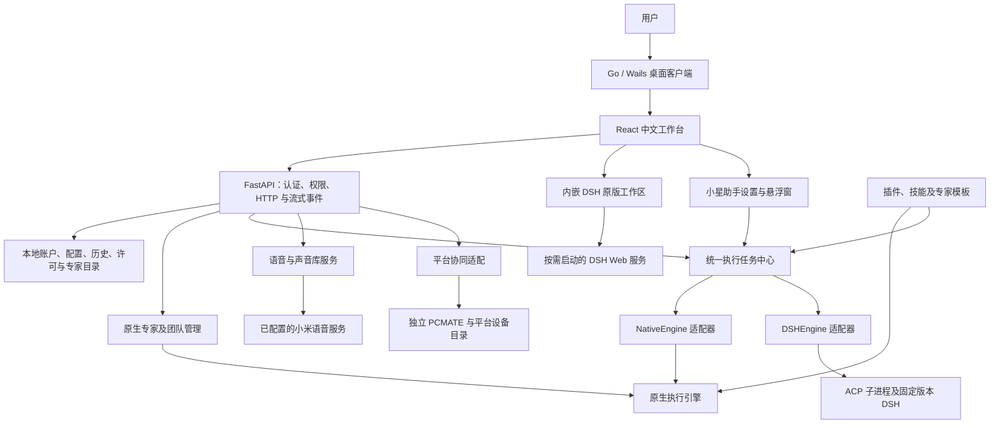

# Singu Xfriend 项目设计说明

版本基线：1.4.4 本地试用版；1.4.5 在线账号联调版。更新日期：2026-10-12。

1.4.5 新增云端个人/企业账号桥、授权管理站 Docker 部署和 DSH 独立输入页，当前进展及限制见 [实施记录](development/xfriend-cloud-account-implementation.md)。本文原有 1.4.4 交付基线保留；新版本的启动和安装验收单独记录。

本文描述当前代码与本地 Windows 交付的设计。历史讨论见 [1.2 起的改造方案](xfriend-1.2-design.md)，实施过程见 [项目日志](development/xfriend-project-log.md)，逐版本变化见 [更新记录](../CHANGELOG.md)。源码实现、本机验证、完整安装验收和公网部署分别记录，不互相替代。

## 1. 产品定位与范围

Singu Xfriend 是面向 Windows 的个人 AI 助手与多专家工作台。用户通过一个客户端使用小星助手、专家对话、团队协作、DSH 工作区、声音库和平台协同。

设计目标是把任务、专家、工具和结果放在同一工作台中。普通专家不应等待 DSH 或未使用的渠道全部启动；用户也不需要分别启动多个引擎才能完成一个任务。

1.4.4 Windows x64 安装包采用本地五天试用。1.4.5 增加云账号桥与在线授权，独立后台已部署到 43.136.175.19 的 `/xfriendmanager/`，短信尚未配置，真实用户注册暂不可用。RDP/SSH、OpenAI 账号登录导入仍属于预留设计。

## 2. 总体架构

图中的原生团队与跨引擎任务中心是不同的编排路径。原生团队沿用已有专家管理；跨引擎任务中心通过适配器串联专家，不表示所有旧团队已自动转换成混合引擎团队。

| 层 | 技术与职责 | 主要代码 |
| --- | --- | --- |
| 桌面宿主 | Go / Wails：窗口、托盘、单实例、服务启动、代理与健康监控 | `desktop/src/` |
| 界面 | React 18、TypeScript、Vite：登录、专家、会话、任务和设置 | `dashboard/src/` |
| HTTP 适配 | FastAPI、Uvicorn：路由、认证、流式传输与错误映射 | `src/octop/api/` |
| 业务核心 | 专家生命周期、执行编排、插件、语音、授权、备份 | `src/octop/infra/` |
| 持久化 | SQLite；服务端模式兼容 PostgreSQL | `src/octop/infra/db/` |
| 原生运行时 | 既有 harness 与模型提供方适配 | `src/octop/infra/agents/` |
| DSH 运行时 | Node 子进程、ACP 合约、原版 Web 工作区 | `src/octop/infra/engines/` |

依赖从界面和 HTTP 层流向业务核心，业务核心不导入 HTTP、CLI 或启动装配模块。内部 Python 包名及依赖名保留兼容性；产品展示名称采用 Singu Xfriend。

## 3. 专家、引擎、插件与团队

### 3.1 对象职责

| 对象 | 定义 | 不能混淆的边界 |
| --- | --- | --- |
| 专家 | 面向用户的角色、提示词、记忆、工作区和能力配置 | 专家名称不是模型名称，也不是引擎进程 |
| 引擎 | 执行会话、工具调用、权限交互及取消的运行能力 | 原生与 DSH 有各自的会话和恢复语义 |
| 插件 | 提供能力、工具、技能或专家模板的扩展包 | 当前不是任意第三方引擎均能无代码注册的通用框架 |
| 原生团队 | 既有团队角色与成员编排 | 不自动等同于跨引擎任务中心 |
| 跨引擎任务 | 有明确步骤、专家与引擎来源的协作记录 | 当前以顺序步骤执行，不是无限并行、自主递归的代理网络 |

“引擎也可以作为专家入口、以插件方式交付”是产品组织方式。内部仍保留上述职责，避免把角色配置、进程管理和软件升级耦合为同一个对象。

### 3.2 统一执行路径

`ExecutionEngine` 定义 `execute`、`cancel`、`close`；`ExecutionContext` 传递用户、专家、会话、工作区与引擎会话信息。`NativeEngine` 复用原有网关和历史，`DSHEngine` 连接 DSH ACP 会话。专家绑定决定新会话使用哪个引擎，已有历史沿用原有路径。

执行任务中心支持最多四步顺序协作，保存步骤、引擎版本、工具事件、权限等待、提问回答及最终结果。示例流程为原生规划专家 → DSH 执行专家 → 原生审核专家。双引擎入口可为本次任务选择不同专家和引擎组，再交由指定专家汇总，不必修改专家默认绑定。

重启后仍活动的任务标为中断，不自动重放可能已经执行过的命令。继续对话与任务重试由明确的用户操作触发。

### 3.3 DSH 界面与版本同步

保留 DSH 原版项目、会话、对话、轨迹、插件及输入界面，在 Xfriend 内打开；对应 Web 服务按需启动。原版工作区和 ACP 执行入口保留各自的会话管理边界，不承诺两种入口的历史自动互相转换。

随包 DSH 固定为 `0.2.1-alpha.2`，上游提交 `d743267388641bc76f17c45ce8b4c231aed1d32c`。升级采用候选包导入、清单和文件校验、ACP 初始化及恢复检查、测试任务验收，再切换默认版本。已有受管理会话固定原运行时；不自动跟随上游主分支覆盖生产版本，也不承诺上游新增功能自动同步。

## 4. 小星助手与声音能力

小星提供桌面悬浮入口、文字输入、专家选择及语音交互。监听默认关闭，由用户手动开启；唤醒词可修改，默认“小星”。语音识别可以使用已配置服务，不承诺离线唤醒或离线识别。

语音服务覆盖 ASR、TTS、VoiceDesign 与 VoiceClone。个人声音库负责导入 WAV/MP3、描述生成、试听、命名、删除及默认克隆参考。用户偏好可以选择服务、声音和自动朗读策略，空值继承系统设置。

小星通过统一执行入口调用专家；语音前处理和朗读不成为所有普通专家启动的共同依赖。远程语音请求会把相应录音或文本发送给已配置服务，服务凭据由受权限保护的配置管理，不写入文档或安装包的默认账号配置。

## 5. 对话与结果导出

导出范围支持单轮问答、勾选多条消息、起止范围和整个会话；格式支持 PDF、HTML、DOCX 和 PNG，多页图片可打包。导出读取完整归档，协作任务标明专家及引擎来源。

导出与当前执行状态分开，避免为了读取历史而提前加载全部执行 SDK。复杂表格、代码块、长文分页和多专家产物需要持续补充样本验收；不能只凭文件生成成功认定全部排版质量达标。

## 6. 启动设计与性能目标

### 6.1 启动顺序

1. Go 桌面宿主提供编译进程序的界面，初始进入中文登录页，输入不等待 Python 服务。
2. 校验安装目录的运行版本、入口和界面指纹；首次版本切换执行必要的数据库备份。
3. 启动本地 Python 服务，装配账户、配置、历史和核心 API，开放真实认证。
4. 没有管理员账号时进入注册向导；已有账号通过真实认证进入工作台。
5. 优先恢复普通专家，再补齐可选路由和背景能力。尚未挂载的可选 API 返回可重试状态。
6. 用户打开 DSH 原版页面时启动其 Web 服务；普通专家不等待该服务。

### 6.2 减少实际加载工作

- NSIS 在安装时展开版本化运行目录，桌面 EXE 不再内嵌整个运行 ZIP，首启不再重复解压。
- 构建预编译 Python 字节码，并生成 `startup-code.zip`；启动一次读取到内存，减少逐模块打开文件。资源、元数据、源码和原生扩展仍保留真实磁盘路径。
- 为固定版本 deepagents 的能力检测应用经过源码哈希校验的延迟导入补丁，只修改发行暂存内容。
- 内置专家资料在构建时生成双语索引，减少启动遍历与 Markdown 解析。
- 安装版升级只在启动路径备份必要数据库，不复制全部工作区及附件。同版本重开跳过升级备份。

当前没有把整个 Python 系统编译成原生 DLL。后续是否采用 Nuitka/Cython，应依据热点剖析与兼容性验证决定。

### 6.3 验收口径

普通专家目标为 10 秒左右就绪、最长 16 秒；分别测量界面可输入、登录完成、专家实际运行和模型首字，不能用空窗口或健康探针代替专家对话验收。

1.4.4 最终三轮隔离进程重启中，已有单个专家分别在 11.662、11.196、11.909 秒就绪，真实对话全部完成。原生首屏单次检查为 5.618 秒。此前有额外负载时出现 20.666 秒样本，新建工作区也更慢，因此尚不承诺所有机器、所有负载和系统重启冷启动均达标。完整定义与证据见 [启动验收记录](development/xfriend-1.4.4-startup.md)。

## 7. 数据、升级与恢复

| 内容 | 位置与策略 |
| --- | --- |
| 程序与依赖 | 安装目录下 `runtimes/<版本>/`，由 `runtime-release.json` 选择 |
| 账号、配置与历史 | 默认用户目录 `.xfriend`；可由 `XFRIEND_HOME` 指定 |
| 专家工作区 | 使用既有受管理路径或明确配置的外部工作区；升级不迁走外部目录 |
| DSH 数据 | 用户数据目录的 `engine-data/dsh/`，按用户及运行时身份隔离 |
| 插件附加 Python 依赖 | 用户目录 `python-dependencies`，避免写入 Program Files；自带核心库优先 |
| 本地试用锚点 | Windows 用户本地应用数据和注册表，DPAPI 保护，沿用原计时 |

数据库备份使用 SQLite 在线 backup 与完整性检查；它是逐库快照，不承诺跨多个数据库的同时刻原子快照。恢复发布到全新目录，保留原数据；恢复副本的自动任务需检查后再启用。PostgreSQL 不适用本地 SQLite 文件备份流程。

旧运行目录可保留，但当前没有完整的自动程序降级与数据库自动回滚。生产安装器已经编译，完整覆盖安装和干净 Windows 首装仍需单独验收。

## 8. 试用与在线授权

当前发行配置为 `local_trial`、`trial_days=5`，无需激活网站。覆盖升级不重新计时，到期保留数据。彻底重装系统或清除全部本地试用记录后的同机限制，需要服务器授权解决。

在线授权代码采用机器绑定、服务器签名证书与本地验签；独立后台位于 `D:/xfriend-activation`，目标地址为 `https://www.ciyuancenter.cc/xfriendmanager`，计划部署到 `43.136.175.19`。管理端支持机器查询、延期、续费、停用及可选兑换码。当前后台策略准备为新机器五天试用，已有授权保留到期日。

生产上线需要真实部署、HTTPS 验收、管理员可信导出的公钥配置和客户端联调。私钥只留在服务器；本地五天安装包不能当作已接通在线激活的版本。

## 9. 平台协同与预留能力

PCMATE 保持独立软件，Xfriend 通过平台协同入口接入平台账号、组织与设备目录。共享无界面协同核心、远程控制和设备隧道属于进一步整合范围，当前不能宣称已完成。平台真实账号业务验收按用户要求跳过。

RDP/SSH 后续可统一设备连接配置、凭据引用、权限与连接日志，再分别调用 RDP 客户端或 SSH 会话；当前不作为已交付能力。ChatGPT 订阅接入只保存新的开发接口合同，尚未实现或启用该新流程；旧登录入口不代表会员订阅已经能作为本产品模型额度。接口预留说明见 [开发文档](development/chatgpt-subscription-interface.md)，该开发说明不进入当前安装包。

## 10. 维护与后续工作

| 优先级 | 工作 | 完成证据 |
| --- | --- | --- |
| P0 | 干净 Windows 首装、旧版覆盖升级、试用与历史保留 | 实际安装流程及升级前后数据核对 |
| P0 | 多轮冷启动、多个专家、睡眠唤醒与长时间运行 | 固定条件样本、P50/P95、错误分类 |
| P1 | 新工作区执行图构建与模型 SDK 初始化继续提速 | 包含首条真实任务的剖析与对照样本 |
| P1 | 在线授权生产部署与客户端接通 | HTTPS API、公钥、首次领取、续费和离线验签验收 |
| P1 | DSH 真实工具任务及升级兼容性 | 权限、取消、恢复、历史和产物回归 |
| P2 | 平台真实业务与复杂导出排版 | 测试账号业务闭环及导出样本检查 |
| P3 | RDP/SSH、共享 PCMATE 协同核心 | 独立设计、实现和安全边界验收 |

开发遵守业务与 HTTP 分层；提交前默认执行 `make all`，前端变更补充类型检查及生产构建，桌面变更执行 Go 测试。版本升级必须同时核对源码版本、桌面资源版本、运行目录、发行策略与安装包校验值。具体命令见 [README](../README.md)。

## 2026-10-12：1.4.6 登录与无短信注册调整

本次调整替代 1.4.5 的短信注册流程。未登录时默认打开登录页，用户点击注册后进入注册页；注册资料中的姓名改为昵称，手机号和邮箱仍作为联系信息保存。注册不再要求短信验证码，用户 ID 由服务器生成 UUID，不由客户端指定。登录支持手机号或邮箱加密码。手机号和邮箱尚未经过所有权验证，不能作为已验证身份宣传。

记住账号与保持登录的偏好沿用：保持登录后重启直接恢复工作台，可在设置退出；不保存密码。注册和登录表单不依赖 Python 或 DSH。忘记密码入口显示联系管理员的说明，未移除密码重置接口的验证码校验，短信服务配置入口继续保留。覆盖升级不清除已有账号库、授权库、签名密钥或客户端用户数据。

专项验证：管理端 41 项测试通过，变更文件 Ruff 与 mypy 通过；前端 4 项登录注册测试、TypeScript 和生产构建通过；Go 全套测试通过。全量 make all、安装包构建及线上部署结果另行记录。企业自助邀请、旧本地数据关联、干净系统安装和专家启动时间仍不属于本次已验收项。

### 1.4.7 登录预加载与专家传输

登录页由 Go 静态界面服务独立提供，不等待 Python。Go 同时启动仅导入公共库的 Python 预加载进程，认证完成后通过继承管道传递用户空间路径及本机桥参数，在同一进程内启动服务。认证前禁止打开用户账号数据库和历史目录；DSH 保持按需启动，不加入普通专家的就绪依赖。

云账号的真实本机访问令牌只保存在 Go 桥中。HTTP 和 WebSocket 均由桥注入 Bearer 请求头；Python 聊天与通知 WebSocket 使用同一令牌提取规则，并兼容网页版查询参数。页面不需要持有云刷新令牌或本机 JWT，通知连接也不应以页面 JWT 是否存在判断云账号登录状态。
